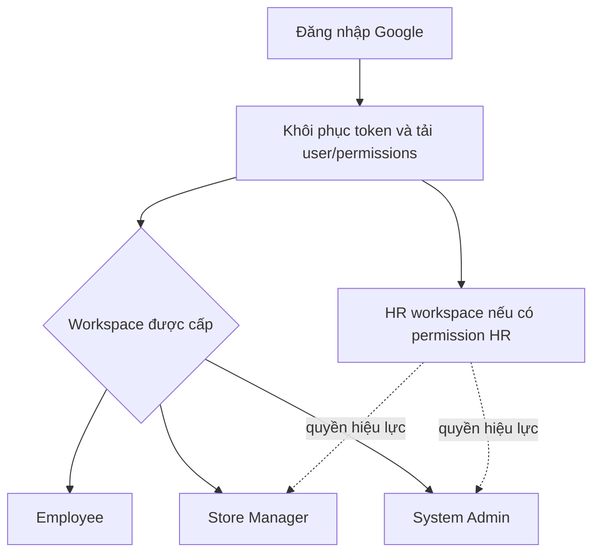
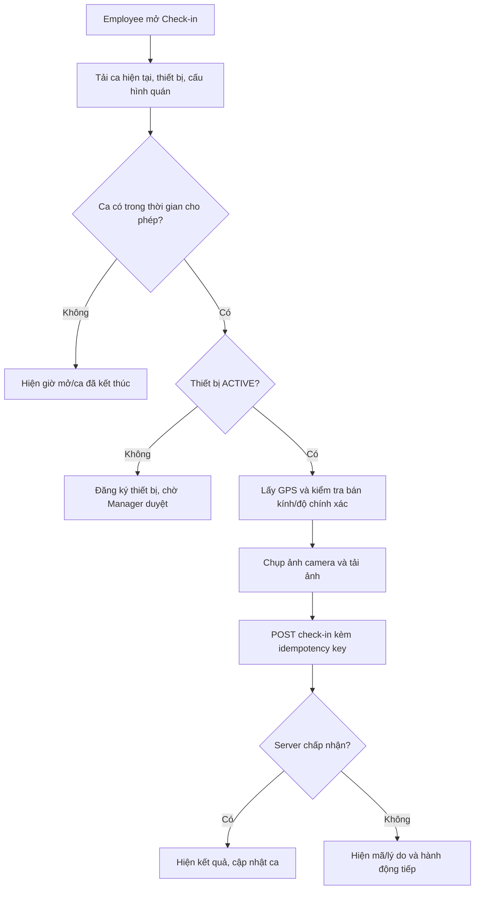

# Rà soát luồng và đề xuất màn hình HRM Coffee Shop

**Mục đích:** tài liệu để chủ dự án xem và chốt luồng/màn hình trước khi tiếp tục đổi giao diện hoặc nghiệp vụ. Đây là bản rà soát source hiện tại, không phải cam kết rằng mọi luồng đã được chạy end-to-end trên dữ liệu thật.

**Phạm vi rà soát:** Flutter routes, màn hình, API repositories; Spring Boot controllers, DTO/service và quyền; SRS HRM Coffee Shop v2.0; file API Reference được cung cấp. Dự án dùng SQL Server tại `hrm-coffeeshop-backend/infra/sqlserver`; đề xuất dưới đây giữ nguyên backend/database hiện có trừ khi ghi rõ cần quyết định thay đổi API.

## 1. Cách đọc và nguồn đối chiếu

- **Đang có:** hành vi thấy trong code Flutter/backend tại workspace.
- **Đề xuất:** cách trình bày hoặc điều hướng được đề xuất, chưa có nghĩa là nghiệp vụ đã được chốt.
- **Cần chốt:** hai lựa chọn làm thay đổi cách người dùng hiểu hoặc sử dụng tính năng.
- Khi tài liệu API và code hiện hành lệch nhau, controller/DTO/service xác định API đang chạy; API Reference cần được cập nhật theo sau.

Nguồn chính: `lib/app/router/app_router.dart`, `lib/app/router/route_names.dart`, `lib/data/repositories/employee_repository.dart`, `lib/features/**/presentation`, `hrm-coffeeshop-backend/src/main/java/com/hrm/coffeeshop/**/controller`, `shared/service`, `shared/dto` và `hrm-coffeeshop-backend/infra/sqlserver/seeddata.sql`.

## 2. Nhận định tổng quan

App đã có màn hình API thật cho ba role Employee, Store Manager, System Admin; năng lực HR được dựng theo permission của tài khoản, không phải role riêng. Các luồng chính đã có route gồm check-in/out, lịch, checklist, đào tạo/quiz, duyệt thiết bị, duyệt checklist/attendance, hồ sơ, nhân viên, báo cáo, tài khoản và cấu hình.

Phần cần ưu tiên khi hoàn thiện là tính dễ tìm của các chức năng quản lý, trạng thái lỗi/điều kiện bị chặn, thống nhất tên và trạng thái giữa API Reference với code, cùng một số lựa chọn chính sách vẫn còn hiển thị trái với nghiệp vụ hiện hành. Việc một route có mặt chưa chứng minh toàn bộ vai trò, quyền, thiết bị và dữ liệu thật đã được kiểm thử cùng nhau.

| Nhóm | Hiện trạng trong source | Nhận định |
|---|---|---|
| Đăng nhập và chọn workspace | Google login, phục hồi phiên, lấy quyền hiệu lực, chọn workspace | Nên tiếp tục dùng quyền backend để quyết định workspace và hành động |
| Employee | Dashboard và các luồng cá nhân có route/API | Cần làm rõ trạng thái ca/thiết bị/GPS và cách tới các đơn chờ duyệt |
| Manager | Dashboard, nhân viên, lịch, approvals, thiết bị, báo cáo và nghiệp vụ | Một số công cụ vận hành nằm trong menu phụ; cần gom điều hướng theo việc hằng ngày |
| Admin | Tài khoản, chức vụ, đào tạo, checklist, cấu hình, log | Dashboard chỉ hiển thị số liệu có API; không có số nhân viên/biểu đồ xu hướng hiện tại |
| HR | Workspace dựng theo permission; có hàng chờ điều chỉnh công và các quyền nghiệp vụ khác | Chưa phải mọi permission HR đều có liên kết trực tiếp trong workspace |
| API docs | API Reference có endpoint nghiệp vụ nền tảng | Thiếu API quiz đang có trong backend; cần đồng bộ tài liệu |

## 3. Mô hình quyền cần giữ trong thiết kế

1. `EMPLOYEE`, `STORE_MANAGER`, `SYSTEM_ADMIN` là role chính.
2. HR là nhóm quyền được cấp cho một user, không thêm role `HR`. Một tài khoản có thể có nhiều role/permission theo cấu hình.
3. Flutter dùng `/users/me` và `/users/me/permissions` để hiện workspace/nút phù hợp. Backend vẫn kiểm tra quyền ở mọi API ghi.
4. `401` đưa người dùng về luồng đăng nhập/refresh phiên; `403` phải hiện lý do thiếu quyền và hướng liên hệ Admin, không được đổi sang dữ liệu giả.
5. Các quyền quan trọng trong các màn hiện tại gồm `DEVICE_APPROVE`, `DOCUMENT_REVIEW`, `TRAINING_MANAGE`, `ATTENDANCE_ADJUST_HR`, `DASHBOARD_MANAGER`, `PAYROLL_VIEW` và các quyền payroll chi tiết.

HR workspace là lối vào công việc theo quyền. Nó không làm tăng quyền của backend và cũng không nên hứa rằng mọi màn hình Manager/Admin đều dùng được nếu tài khoản chưa có permission tương ứng.

## 4. Luồng màn hình đề xuất theo vai trò

### 4.1 Luồng chung và tài khoản

`Login → Google xác thực → nạp hồ sơ/quyền → chọn workspace phù hợp → dashboard`.

Màn tài khoản dùng chung cho tên/điện thoại, đăng xuất và quay lại workspace. Nếu user Employee chưa được liên kết với hồ sơ nhân viên, cần chỉ rõ tài khoản đang thiếu liên kết và ai xử lý; không đưa họ vào dashboard trống.

### 4.2 Employee

Điều hướng đáy hiện có: **Trang chủ · Lịch · Checklist · Cá nhân**. Dashboard có liên kết nhanh tới đào tạo, thông báo, chấm công, hồ sơ giấy tờ, vi phạm, thưởng/phạt và các nghiệp vụ review nếu user có permission.

| Luồng | Các màn/action | API/backend chính | Trạng thái/điểm UI phải thể hiện |
|---|---|---|---|
| Trang chủ | Thông tin user, ca hiện tại/tiếp theo, checklist và thông báo | `/employees/me`, `/dashboard/employee/overview`, `/attendance/me/current`, `/notifications/me/unread-count` | Tải lỗi có nút thử lại; ca qua nửa đêm cần hiển thị cả ngày bắt đầu/kết thúc |
| Check-in/out | Dashboard → Check-in → điều kiện → xác minh → kết quả; Check-out tương tự | `/attendance/me/current`, `/attendance/devices/me`, `/stores/current`, `/storage/uploads`, `/attendance/check-in`, `/attendance/check-out` | Chỉ backend quyết định ca hợp lệ; app nêu lý do thiếu ca, giờ chưa mở, thiết bị, GPS, sai số, ngoài vùng, ảnh hoặc quyền |
| Đăng ký thiết bị | Check-in → đăng ký thiết bị → trạng thái PENDING → quản lý duyệt → tải lại trạng thái ACTIVE | `/attendance/devices/register`, `/attendance/devices/me`; manager `/attendance/devices/pending` và `/{id}/approve` | Hiện rõ nhãn máy, thời gian gửi, PENDING/ACTIVE/REJECTED; nếu có PENDING thì không gửi yêu cầu trùng |
| Lịch | Tuần/tháng → chi tiết assignment → điều kiện/chi nhánh/ca | `/shift-assignments/me`, `/shift-assignments/{id}`, `/shift-assignments/{id}/eligibility` | Cho biết ca đã công bố/hủy và ngày kết thúc nếu qua nửa đêm |
| Lịch sử công | Danh sách theo ngày → chi tiết → lịch sử xác minh; gửi giải trình/chỉnh công/tăng ca | `/attendance/me`, `/attendance/{id}`, `/attendance/{id}/verifications`, các `...requests/me` | Hiện trạng thái yêu cầu, phản hồi quản lý, minh chứng và retry hợp lệ |
| Checklist | Danh sách → mở task → bắt đầu → hoàn thành item/tải ảnh → gửi duyệt | `/checklists/me`, `/checklists/tasks/{id}`, `/start`, `/items/{id}/complete`, `/evidence`, `/submit` | Lưu trạng thái sau từng thao tác; nêu item còn thiếu trước khi submit; cho làm lại khi bị trả |
| Đào tạo | Khóa học/yêu cầu → ghi danh → quiz hoặc chờ xác nhận hoàn thành → kết quả | `/training/courses`, `/training/me`, `/training/me/requirements`, `/training/courses/{id}/enroll`, quiz API ở mục 7 | Với khóa có quiz, chấm theo `passScore`; khóa không có quiz cho Manager/Admin xác nhận hoàn thành |
| Hồ sơ/giấy tờ | Hồ sơ cá nhân → loại giấy tờ → tải file → gửi → xem trạng thái | `/employees/me/documents`, `/storage/uploads?purpose=DOCUMENT`, `POST /employees/me/documents` | Giữ storageKey nội bộ; hiển thị PENDING/APPROVED/REJECTED và lý do |
| Thông báo | Tất cả/chưa đọc → mở → đánh dấu đã đọc/đọc tất cả | `/notifications/me`, `/notifications/{id}/read`, `/notifications/read-all` | Badge đồng bộ với unread count; deep link tới đúng yêu cầu nếu có |
| Vi phạm/thưởng phạt | Danh sách cá nhân → chi tiết/giải thích; quyết định thưởng phạt | `/violations/{id}`, `/violations/{id}/explanations`, `/rewards-penalties/me` | Không cho Employee xác nhận/từ chối quyết định của Manager |

#### Luồng check-in cần trình bày như quy trình, không như một nút đơn

Điều kiện backend hiện gồm Employee `ACTIVE`, assignment `PUBLISHED`, đúng cửa sổ giờ, thiết bị `ACTIVE` của chính Employee, GPS hợp lệ/trong vùng, ảnh lưu hợp lệ và kỳ công chưa khóa. Service hiện không chặn check-in bởi tiến độ training. GPS và camera trên emulator còn phụ thuộc quyền hệ điều hành và cấu hình AVD.

### 4.3 Manager

Điều hướng đáy hiện có: **Tổng quan · Nhân viên · Lịch · Duyệt · Khác**.

| Màn hình | Nhiệm vụ | API/backend chính | Gợi ý tổ chức |
|---|---|---|---|
| Dashboard | Tóm tắt attendance, việc chờ xử lý, nhân sự/operations | `/dashboard/manager/overview`, `/attendance`, `/employee-status`, `/operations`, `/rewards-penalties` | Card việc chờ bấm được và đưa đến đúng queue; không chỉ hiện số |
| Nhân viên | Tìm kiếm/danh sách → hồ sơ → ca, công, đào tạo, giấy tờ, kỹ năng | `/employees`, `/{id}`, `/{id}/overview`, `/attendance-summary`, `/training`, `/documents`, `/skills` | Tabs theo công việc; khóa trường nhạy cảm theo permission |
| Lịch | Danh mục ca → lịch tuần/tháng → phân ca/sửa/hủy → chi tiết/điều kiện | `/work-shifts`, `/shift-assignments`, `/{id}`, `/{id}/eligibility` | Tách mẫu ca (quản trị cấu hình) khỏi lịch đã phân; cảnh báo đè ca/ca qua đêm |
| Duyệt yêu cầu | Giải trình, chỉnh công, OT, checklist, thiết bị, hồ sơ, khóa học, vi phạm, thưởng/phạt | Các endpoint `pending/list`, `approve`, `reject` tương ứng | Queue cần filter theo trạng thái, loại việc, ngày; reject bắt buộc lý do nếu DTO yêu cầu |
| Thiết bị | Xem đăng ký, người gửi, nền tảng, thời gian; duyệt/từ chối; xem thiết bị nhân viên/thu hồi | `/attendance/devices/pending`, `/employees/{id}`, `/{id}/approve`, `/{id}/reject`, `/{id}/revoke` | Lối vào đã có ở Duyệt và menu Khác; tự làm mới khi mở. Quyền `DEVICE_APPROVE` bắt buộc |
| Checklist vận hành | Chọn template/ca/ngày/employee → tạo → giao lại → xem minh chứng → duyệt/trả | `/checklists/instances/generate`, `/instances`, `/reviews/pending`, `/reassign`, `/approve`, `/reject` | Cần thấy rõ ai chịu trách nhiệm, deadline và lịch sử trả lại |
| Báo cáo | Attendance theo ngày/ca/người, operations, payroll readiness | `/reports/attendance`, `/reports/operations`, `/reports/payroll-readiness` | Có bộ lọc khoảng thời gian và trạng thái loading/empty/error |
| Kỳ công | Xem kỳ/readiness → manager confirm hoặc đề nghị xử lý ca vắng | `/payroll-periods`, `/{id}/readiness`, `/{id}/manager-confirm`, `/{id}/absence-requests` | Giải thích từng blocker readiness trước khi xác nhận |
| Thưởng/phạt/vi phạm | Tạo đề xuất, duyệt, từ chối, hủy; review violation | `/rewards-penalties`, `/rule-catalog`, `/violations` | Hiển thị số tiền/lý do/ngày hiệu lực, không chỉ trạng thái |

### 4.4 Admin

Điều hướng hiện có: dashboard và các vùng **Tài khoản · Chức vụ · Đào tạo · Checklist · Cấu hình/Khác**.

| Màn hình | Nhiệm vụ | API/backend chính |
|---|---|---|
| Dashboard | Số tài khoản active, khóa học, template checklist, cửa hàng | `/admin/users`, `/training/courses`, `/admin/checklist-templates`, `/stores/current` |
| Tài khoản/quyền | Tạo tài khoản, gán role, active/disable, xem/gán permission | `/admin/users`, `/permission-catalog`, `/{id}/roles`, `/{id}/permissions`, `/{id}/status` |
| Hồ sơ nhân viên | Tạo/liên kết hồ sơ, chức vụ, loại hợp đồng, trạng thái | `/employees`, `/admin/job-positions` |
| Chức vụ/giấy tờ | CRUD chức vụ, loại giấy tờ, yêu cầu giấy tờ/đào tạo theo chức vụ | `/admin/job-positions`, `/document-types`, `/{id}/document-requirements`, `/{id}/training-requirements` |
| Khóa học | CRUD khóa học, ngưỡng điểm, thời hạn; quản lý câu hỏi và đáp án | `/admin/training/courses`, `/admin/training/courses/{id}/questions` (quiz endpoints hiện có trong backend nhưng thiếu trong API Reference) |
| Checklist template | CRUD template/item, activate | `/admin/checklist-templates` |
| Cấu hình cửa hàng | Tọa độ GPS, bán kính, sai số cho phép, chính sách công, reminder rules | `/admin/store-settings`, `/admin/attendance-policies`, `/admin/reminder-rules` |
| Danh mục kỹ năng | Tạo skill catalog | `/admin/skills` |
| Nhật ký/giao nhận | Tìm audit log, chi tiết, export CSV; notification delivery | `/admin/audit-logs`, `/{id}`, `/export`, `/admin/notification-deliveries` |

Dashboard hiện chủ ý không giả lập số nhân viên/biểu đồ xu hướng vì API Admin không cấp dashboard nhân sự đó. Nếu muốn đúng ảnh tham khảo cần chốt API/quyền trước, không chỉ thêm số giả vào UI.

### 4.5 HR permission workspace

HR workspace hiện sinh tác vụ từ quyền hiện có: điều chỉnh công ở bước HR, đối soát/chốt kỳ, nhân viên, duyệt giấy tờ, đào tạo, báo cáo. Đề xuất thêm một danh sách tác vụ theo quyền, gồm cả `DEVICE_APPROVE` nếu quyền này được cấp, thay vì để HR phải biết route của Manager.

Kiểm tra quyền backend khi mở từng action. Không chuyển tài khoản HR thành role riêng và không cấp ngầm mọi quyền của Manager.

## 5. Ma trận bao phủ theo nhóm API

Ma trận này xác nhận có đường màn hình/repository phù hợp trong source; **không** khẳng định mọi endpoint đã được thử với mọi role trên server đang chạy.

| Nhóm API trong API Reference/backend | Màn hình/luồng hiện có | Đánh giá rà soát |
|---|---|---|
| Google auth, refresh/logout, user/profile/permissions | Login, role selection, account profile, session repository | Có luồng; workspace là permission-driven |
| Employee profile/list/detail/overview/status/documents/skills | Employee dashboard, Manager roster/detail, HR workspace | Có một phần theo quyền; cần kiểm tra các tab chi tiết theo permission thực tế |
| Schedule catalog, assignment CRUD/detail/eligibility | Employee schedule, Manager schedule và shift catalog | Có; cần đặc biệt thể hiện date rollover cho ca qua đêm |
| Check-in/out/current/history/detail/verification/summary | Employee check-in/history; Manager reports/detail | Check-in/out có luồng chính; chi tiết verification/manager adjustment còn phân tán và cần review về khả năng tìm thấy |
| Device registration/list/pending/approve/reject/revoke | Employee check-in; Manager device approval/approval queue | Có; lối vào manager được làm rõ trong menu Khác và tự refresh |
| Explanation/adjustment/overtime | Employee attendance history/forms; Manager attendance approvals; HR adjustment queue | Có; hai bước Manager → HR phải hiện rõ trạng thái đang ở bước nào |
| Checklist template/employee execution/manager generation-review | Admin template page, Employee checklist, Manager checklist approvals | Có; cần xác nhận màn generate/reassign có đủ entry point cho mọi trường hợp ca |
| Course CRUD/quiz/attempt/completion review/progress | Admin course/questions, Employee course/quiz, Manager completion review | Có trong source; **API Reference được cung cấp thiếu quiz question/submit và Admin question CRUD** |
| Document submit/type/review/signed view | Employee profile documents, Admin document types/requirements, Manager/HR document review | Có; API catalog employee dùng loại đang active; giữ file private/signed URLs |
| Violation/rewards/rule catalog | Employee violations/rewards, Manager review/proposal | Có; kiểm tra deep link từ notification và phạm vi HR permission |
| Store/settings/policies/reminders | Admin settings, Employee check-in configuration | Có; GPS capture cần phân biệt tọa độ cấu hình với vị trí máy hiện tại |
| Manager dashboards/reports/payroll | Manager dashboard, attendance/operations reports, payroll | Có các màn chính; kiểm tra các blocker readiness và quyền payroll theo từng action |
| Admin users/audit/notification delivery | Admin account/permission/audit/delivery | Có các màn chính; audit export và detail cần duy trì quyền Admin |
| Shared storage upload/view | Camera, documents, checklist evidence và viewer | Hạ tầng chung; phải giữ storageKey/signature ở client đúng mục đích, không đưa URL nhạy cảm vào log |

## 6. Các điểm lệch hoặc cần rà soát trước khi chốt UI

### 6.1 API Reference cần đồng bộ với backend quiz

File API Reference được cung cấp có `POST /training/courses/{courseId}/attempts` cho Manager ghi kết quả, nhưng không liệt kê các endpoint đang có trong backend:

- Employee `GET /api/v1/training/courses/{courseId}/quiz`.
- Employee `POST /api/v1/training/courses/{courseId}/quiz-attempts`.
- Admin `GET/PUT /api/v1/admin/training/courses/{courseId}/questions`.
- Manager/Admin `GET /api/v1/training/completion-reviews/pending` và approve/not-complete theo `employeeTrainingId`.
- Employee `GET /api/v1/employees/me/documents/catalog`.
- Employee/shared `GET /api/v1/violations/{violationId}/explanations`.

App hiện đã có màn làm quiz, biên tập câu hỏi, duyệt hoàn thành khóa học và danh mục hồ sơ nhân viên. Cập nhật API Reference/OpenAPI handoff để người test tích hợp không tưởng các endpoint này chưa tồn tại.

### 6.2 Mâu thuẫn điều kiện đào tạo trong UI quản trị

Backend hiện tính training eligibility là luôn đủ điều kiện phân ca/check-in; điểm đạt của quiz và thời hạn chứng chỉ vẫn điều khiển kết quả khóa học. Tuy vậy, màn yêu cầu đào tạo theo chức vụ còn công tắc **“Chặn nhận ca khi chưa đạt”**, và DTO vẫn có `blocksShiftAssignment` để tương thích.

**Đề xuất:** ẩn/tắt công tắc này và ghi chú “Yêu cầu đào tạo theo dõi tiến độ; không chặn nhận ca”. Giữ ngưỡng `passScore`, hết hạn khóa học và quy trình xác nhận hoàn thành phù hợp loại khóa. Nếu muốn công tắc có tác dụng trở lại, đó là thay đổi nghiệp vụ/backend riêng.

### 6.3 Tên/định dạng ca qua nửa đêm

Backend lưu `plannedStartAt` và `plannedEndAt` có ngày/offset. UI dashboard hiện chỉ lấy giờ, vì vậy ca từ 08:00 đến 07:59 hôm sau hiển thị như một khoảng cùng ngày và dễ bị hiểu nhầm là lỗi. Quy tắc backend cho phép end nhỏ hơn start nghĩa là kết thúc ngày kế tiếp; chưa thấy giới hạn độ dài ca trong validation ngoài thời lượng nghỉ.

**Đề xuất:** hiển thị `08:00 hôm nay → 07:59 ngày mai` khi date part khác nhau, và xác nhận liệu ca gần 24h trong demo là cố ý hay nên đổi thành ca thường. Nếu cần giới hạn thời lượng tối đa, chốt con số nghiệp vụ trước khi thêm validation.

### 6.4 Truy cập trang quản lý thiết bị

Manager API yêu cầu `DEVICE_APPROVE`; seed mặc định gán quyền này cho role `STORE_MANAGER`. Trang danh sách chỉ truy vấn thiết bị `PENDING`, có thể duyệt/từ chối và mở lịch sử thiết bị của nhân viên. Đường vào trước đây chủ yếu là biểu tượng trong màn Duyệt và action count trên dashboard.

**Đề xuất đã áp dụng trong source:** thêm mục có nhãn “Quản lý thiết bị chấm công” trong menu Khác; khi màn đang mở tự tải lại và khi resume. Nếu API trả 403, kiểm tra quyền hiệu lực `/users/me/permissions`; nếu danh sách rỗng, kiểm tra Employee đã POST register thành công và GET manager pending trả đúng PageResponse.

### 6.5 HR workspace không liệt kê hết quyền

HR workspace dựng liên kết theo nhiều permission, nhưng chưa đưa mọi quyền như `DEVICE_APPROVE` thành action độc lập. **Đề xuất:** tự liệt kê tác vụ theo permission, ưu tiên hàng chờ thiết bị/giấy tờ/attendance/payroll; không gắn nhãn “HR” nếu user chỉ được cấp một quyền phụ lẻ.

### 6.6 Tăng ca qua nửa đêm

UI Employee overtime hiện từ chối giờ kết thúc nhỏ hơn hoặc bằng giờ bắt đầu và ghi rõ chưa hỗ trợ OT qua nửa đêm. Nếu chính sách cửa hàng có OT qua nửa đêm, cần hỗ trợ ngày kết thúc riêng thay vì chỉ chọn hai giờ trong cùng ngày.

### 6.7 Dashboard Admin và biểu đồ nhân sự

Admin dashboard dùng API tài khoản, khóa học, checklist, cửa hàng. Màn hình đã ghi chú không có số nhân viên/biểu đồ xu hướng vì Admin hiện không có dashboard endpoint tương ứng. Quyết định: giữ dashboard theo API hiện có, hoặc mở rộng backend/quyền để bổ sung chỉ số nhân sự; không tạo số minh họa như dữ liệu thật.

## 7. Các lựa chọn đề nghị chủ dự án chốt

Các mặc định đề xuất để review; chưa thay API hoặc mở rộng chính sách nếu chưa được chốt:

| Mã | Nội dung cần chốt | Mặc định đề xuất |
|---|---|---|
| F-01 | Điều hướng Employee | Giữ 4 tab đáy; thao tác ít dùng ở quick links/profile; giữ Check-in CTA nổi bật trên ca hiện tại |
| F-02 | Check-in khi điều kiện chưa đạt | Cho mở trang check-in để xem lý do/đăng ký thiết bị; chỉ disable nút gửi nghiệp vụ khi thiếu điều kiện |
| F-03 | Thiết bị PENDING | Một yêu cầu đang chờ trên mỗi nhân viên; hiển thị trạng thái trên Employee và queue Manager có badge/refresh |
| F-04 | Camera/GPS trên emulator | App lấy camera/GPS hệ điều hành; AVD phải cấu hình Webcam và vị trí test, không thay bằng ảnh giả trong nghiệp vụ |
| F-05 | Ca qua nửa đêm | Hiện rõ ngày kế tiếp; chốt riêng max shift duration và các quy tắc OT qua nửa đêm |
| F-06 | Training requirement | Không chặn nhận ca; quiz đạt `passScore` thì đạt; khóa không quiz do Manager/Admin xác nhận hoàn thành |
| F-07 | HR | Là workspace/task list suy ra từ permission, không tạo role HR |
| F-08 | Admin dashboard | Chỉ số thật có API; muốn số nhân viên/biểu đồ thì chốt endpoint và quyền trước |
| F-09 | Màn duyệt | Một hub có filter và link tới màn chuyên biệt cho chi tiết; không trộn dữ liệu HR review nếu user không có quyền |

## 8. Trình tự demo đề xuất

1. Admin đăng nhập, xác nhận store name/tọa độ/bán kính/sai số GPS, kiểm tra role và permission cho Manager/Employee.
2. Manager kiểm tra mẫu ca, phân ca Employee, kiểm tra ngày/giờ và trạng thái PUBLISHED.
3. Employee đăng nhập trên Android, vào ca → Check-in, đăng ký thiết bị; xác nhận PENDING trên app Employee.
4. Manager mở **Khác → Quản lý thiết bị chấm công**, thấy đúng employee/device, duyệt; Employee refresh/resume và thấy ACTIVE.
5. Employee lấy GPS trong bán kính, chụp ảnh, gửi check-in; đối chiếu response và lịch sử công. Sau đó check-out theo ca.
6. Manager chạy checklist/duyệt checklist, xử lý đơn chấm công và xem report; Admin cấu hình khóa học/câu hỏi, Employee làm quiz, Manager duyệt khóa không quiz.
7. Dùng tài khoản có HR permission để xác nhận tác vụ được hiển thị đúng phạm vi; thử `403` có chủ đích chỉ ở môi trường test.

Chỉ đánh dấu một luồng **end-to-end thành công** khi đã đăng nhập đúng role, gọi backend/database thật trong môi trường test, thao tác trên app và đọc lại trạng thái sau ghi. Widget tests/mocks xác nhận hành vi UI nhưng không thay thế được bước này.

## 9. Danh sách route hiện tại tham khảo

| Vùng | Route chính |
|---|---|
| Auth/workspace | `/login`, `/register`, `/select-workspace` |
| Employee | `/employee`, `/employee/schedule`, `/employee/checklist`, `/employee/training`, `/employee/profile`, `/employee/documents`, `/employee/notifications`, `/employee/attendance-history`, `/employee/violations`, `/employee/rewards`, `/attendance/check-in` |
| Manager | `/`, `/manager/employees`, `/manager/schedule`, `/manager/schedule/work-shifts`, `/manager/approvals`, `/manager/devices`, `/manager/attendance-requests`, `/manager/checklists/approvals`, `/manager/training/completions`, `/manager/reports/attendance`, `/manager/reports/operations`, `/manager/violations`, `/manager/rewards`, `/manager/payroll` |
| Admin | `/admin`, `/admin/accounts`, `/admin/positions`, `/admin/training`, `/admin/training/courses/:courseId/questions`, `/admin/checklist-templates`, `/admin/settings`, `/admin/audit-logs`, `/admin/notification-deliveries`, `/admin/skills`, `/admin/document-types` |
| HR permission workspace | `/hr`, `/hr/attendance-adjustments`; các route manager dùng lại chỉ hiện theo quyền |

## 10. Giới hạn của bản rà soát

- Đây là review source/API và route, chưa phải kiểm thử toàn bộ use-case với nhiều tài khoản trên SQL Server.
- Camera/GPS phải kiểm thử trên thiết bị thật hoặc AVD đã chọn Webcam/đặt vị trí. Camera emulator để `Emulated`/`VirtualScene` có thể trả về cảnh phần mềm.
- Các API được bảo vệ cần JWT thật. Kết quả test widget hoặc service mock không chứng minh rằng user hiện tại có permission, dữ liệu seed của database khớp, hay OAuth được cấu hình đúng.
- SRS định nghĩa nghiệp vụ rộng hơn một số API hiện triển khai; mục “cần chốt” ở đây giữ ranh giới để quyết định tính năng nào là scope demo và tính năng nào cần phát triển tiếp.
