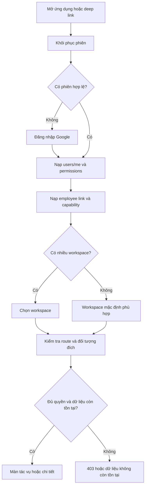

# HRM Coffee Shop — Đánh giá kiến trúc, điều hướng và điều phối nghiệp vụ

> Bản đánh giá/đề xuất trước triển khai. Phần đã thực hiện theo yêu cầu tiếp theo và kết quả chạy thật: [IMPLEMENTATION_LOG.md](IMPLEMENTATION_LOG.md), [IMPLEMENTED_FLOW_MATRIX.md](IMPLEMENTED_FLOW_MATRIX.md), [VERIFICATION.md](VERIFICATION.md). Các mục quyết định chưa được chọn vẫn là đề xuất.

**Ngày rà soát:** 04/11/2026  
**Trạng thái:** Đề xuất thiết kế để chốt phạm vi triển khai. Các flow đích trong tài liệu chưa phải code đã triển khai.

## 1. Kết luận đánh giá

Snapshot đầy đủ case1/c889df1 đã có backend và Flutter tích hợp API cho phần lớn module. Flutter có Google login/restore, secure token storage/refresh, workspace selection, check-in/upload/GPS/camera, màn Employee/Manager/Admin và test nghiệp vụ. Điểm cần hoàn thiện là route/session guards, quyền đọc và xử lý tác vụ, trạng thái nhiều bước, back stack, refresh dữ liệu và liên kết từ notification/blocker tới đúng hồ sơ.

Working tree case2/0af31cb là Flutter cũ hơn còn demo. Không dùng kết luận checkout cũ để nói các chức năng trong case1 chưa tồn tại. Rà soát đã mở rộng sang Flutter case1: 84 file Dart, 48 file page và 25 file Dart test. Các phần đã tích hợp cần được chuẩn hóa và nghiệm thu, không xây lại từ đầu.

| Thành phần | Đánh giá từ source | Hệ quả cần xử lý |
|---|---|---|
| Backend domain/service | Có nhiều rule, transaction, audit, lock và state transition | Tái sử dụng source hiện tại; tập trung xử lý khoảng trống contract và liên kết thay vì viết lại nghiệp vụ. |
| Flutter data/state | Có AuthRepository, EmployeeRepository, ChecklistRepository, NotificationRepository; EmployeeRepository khoảng 1.886 dòng bao nhiều domain, nhiều Map và state trong widget | Tách repository theo domain dần, thêm DTO và provider/controller có refresh dependencies; giữ API đã nối. |
| Authentication/navigation | Google login/restore/refresh/workspace đã có; app_router chưa có redirect/guard trung tâm, / vẫn là Manager | Đưa session/capability vào router; xử lý direct URL, mất phiên và reload workspace. |
| Role/permission | Có role, permission trực tiếp, HR permission set và service guards bổ sung | Role chọn cấu trúc workspace; quyền hiệu lực và trạng thái đối tượng quyết định action. |
| Trạng thái | DB, API và trạng thái hiển thị có thể khác nhau | Lập adapter trạng thái theo domain; giữ tách pha xử lý, kết quả và bước duyệt. |
| Dashboard | Employee/Manager/Admin đã đọc API; Manager dùng pending/nextActions | Hoàn thiện quyền từng queue, training review, priority, link bước cuối và refresh liên module. |
| Liên kết nghiệp vụ | Một số chuỗi đã có; một số dừng ở module riêng | Bổ sung các liên kết ghi trong BUSINESS_LINKAGE_MATRIX.md và chốt policy còn thiếu. |
| Chất lượng runtime | Backend có 42 test Java source; Flutter case1 có 25 test Dart source | Chưa có bằng chứng test pass hoặc nghiệm thu live trong lượt này; mock/widget tests không chứng minh API hoạt động. |

## 2. Baseline và cách đọc

- Baseline đầy đủ: Flutter và backend cùng ref case1 / c889df14360cb583d49c6364f2bdca5d610bf13c, đọc qua Git tree.
- Working tree vẫn ở case2 / 0af31cb547580157e57d04f6dec039a8a229c7cc, là tổ tiên của case1. case2 chỉ làm so sánh lịch sử; không đổi branch.
- Phạm vi cửa hàng hiện tại: StoreService mô tả cửa hàng duy nhất và chọn cửa hàng active đầu tiên. Tài liệu đích sử dụng phạm vi một quán; không khẳng định hỗ trợ quản lý nhiều chi nhánh.
- MASTER_SPECIFICATION.md chính thức chưa có trong checkout. Draft V3.0 trong hội thoại là đầu vào thiết kế, chưa được coi là bản đã phê duyệt.
- Rà soát source và tài liệu; chưa chạy app, backend, test, OpenAPI hoặc SQL Server trong lượt này.

Bộ tài liệu chi tiết:

1. [END_TO_END_WORKFLOWS_AND_STATES.md](END_TO_END_WORKFLOWS_AND_STATES.md): flow từng nghiệp vụ, trạng thái hiện có và quy tắc hiển thị.
2. [BUSINESS_LINKAGE_MATRIX.md](BUSINESS_LINKAGE_MATRIX.md): quan hệ upstream/downstream, refresh màn hình, blockers và deep links.
3. [BUSINESS_DECISION_REGISTER.md](BUSINESS_DECISION_REGISTER.md): quyết định đã có định hướng, quyết định còn thiếu và đề xuất xử lý.
4. [API_SCREEN_PERMISSION_MATRIX.md](API_SCREEN_PERMISSION_MATRIX.md): mapping endpoint/controller/DTO/service/quyền/entity/test hiện có.
5. [SOURCE_AUDIT.md](SOURCE_AUDIT.md), [BUSINESS_GAP_ANALYSIS.md](BUSINESS_GAP_ANALYSIS.md), [EXISTING_WORKFLOW_MAP.md](EXISTING_WORKFLOW_MAP.md): bằng chứng audit nền.

## 3. Các vấn đề cần giải quyết

P0 là điều kiện để người dùng thao tác thật. P1 là điều kiện để các nghiệp vụ vận hành liền mạch. P2 phục vụ độ bền, khả năng mở rộng và bảo trì.

| Mã | Mức | Phát hiện có bằng chứng source | Hướng hoàn thiện |
|---|---|---|---|
| ARC-01 | P0 | Working tree case2 là bản cũ; ref case1 chứa cả Flutter tích hợp lẫn backend đầy đủ | Dùng một baseline thống nhất khi triển khai/nghiệm thu; không kết luận thiếu chức năng chỉ từ checkout cũ. |
| ARC-02 | P0 | Login case1 có auth thật nhưng bootstrap nằm trong Login; router không có guard/redirect, workspace route cần User trong state.extra | Session/capability vào router; direct URL/reload/401 phải resolve lại và giữ đích. |
| ARC-03 | P0 | Check-in case1 đã upload/gọi API; chọn bản ghi ACTIVE đầu tiên của user, không đối chiếu thiết bị cài app hiện tại; server chỉ kiểm tra deviceId/owner/status | Chốt binding thiết bị thật; nghiệm thu camera/GPS/retry. Record ACTIVE hiện chưa chứng minh đúng máy vật lý. |
| ARC-04 | P0 | Action permission đôi khi chưa đủ để đọc queue/detail; ví dụ adjustment HR cần quyền đọc và STAFF_REVIEW ngoài action | Xác định capability end-to-end cho từng tác vụ; hiển thị đúng module và xử lý 403 rõ ràng. |
| ARC-05 | P0 | Chỉ có ba role chính trong thiết kế nhưng bước HR vẫn cần người được cấp ATTENDANCE_ADJUST_HR/PAYROLL_FINALIZE | Chỉ định người chịu trách nhiệm bước cuối trong ba role; HR là nhóm quyền, không tạo role thứ tư. |
| ARC-06 | P1 | Attendance, violation, reward và payroll có mapping DB → API khác nhau | Dùng public DTO làm contract Flutter; có state adapter theo domain và fallback unknown state. |
| ARC-07 | P1 | Một form adjustment có thể tạo hai request độc lập cho CHECK_IN và CHECK_OUT; AdjustmentView không có đầy đủ note/timeline từng bước duyệt | Thể hiện đúng đơn vị yêu cầu hiện tại; chốt có cần một hồ sơ điều chỉnh atomic và history API hay không. |
| ARC-08 | P1 | Training review queue lấy mọi enrollment non-quiz chưa pass còn hiệu lực; không có employee submit-completion flow | Giữ nhãn phù hợp với flow đơn giản đã yêu cầu hoặc chốt thêm bước employee báo hoàn thành; không giả lập PENDING_REVIEW. |
| ARC-09 | P1 | Manager UI dùng nextActions, chỉ kiểm thêm quyền documents; adjustmentsAwaitingHr có route null; approval hub gọi 14 request qua Future.wait | Capability từng queue, isolate lỗi/403, link đúng bước cuối và bổ sung training; không tải mọi queue cho mọi user. |
| ARC-10 | P1 | Violation được ghi từ attendance/checklist; DecisionRequest không nhận violationEventId và create service chưa ghi liên kết đó | Chốt liên kết violation → penalty trước khi công bố flow phạt end-to-end. |
| ARC-11 | P1 | Điều chỉnh/giải trình tính lại attendance nhưng không gọi cơ chế đối soát lại violation/penalty liên quan | Sau thay đổi công, tạo tác vụ rà soát hậu quả nghiệp vụ; không tự sửa quyết định tiền/kỷ luật ở Flutter. |
| ARC-12 | P1 | Một số notification target không có GET-by-id; EmployeeRewardPenalty notification dùng ID số trong khi action API dùng REWARD-/PENALTY- | Hoàn thiện resolver đối tượng và contract đọc chi tiết để deep link tồn tại qua reload/đăng nhập lại. |
| ARC-13 | P1 | PayrollService quản lý readiness/chốt công; chưa thấy payslip, công thức lương, payroll line items hoặc đường chuyển decision sang APPLIED | Gọi đúng chức năng “Kỳ công / đối soát”; chốt phạm vi nếu sản phẩm cần tính lương tiền. |
| ARC-14 | P1 | Push, face verification, upload scanning đang dùng Logging/Noop adapters | Xác định phạm vi demo/production và adapter thật cần có; không hiển thị đã xác minh/gửi push khi backend chưa thực hiện. |
| ARC-15 | P2 | Nhiều Map/string; repository bỏ một số page metadata; Admin dashboard quét tối đa 100 trang; ApiException không giữ error.code và thay mọi 403 bằng thông báo chung | DTO/page/count rõ; giữ error.code/lý do nghiệp vụ; không coi dữ liệu bị cap là tổng tuyệt đối. |
| ARC-16 | P2 | Có status hợp lệ ở schema nhưng không tìm thấy action chuyển vào status đó | Không tạo nút “hoàn thành/miễn/áp dụng lương” chỉ vì enum tồn tại. Chốt transition trước khi bổ sung API/UI. |
| ARC-17 | P2 | Quiz lưu điểm/lượt thi nhưng không thấy snapshot câu hỏi/câu trả lời từng lượt; câu hỏi được thay toàn bộ | Chốt yêu cầu lưu chứng cứ/lịch sử học; version câu hỏi nếu cần tái hiện kết quả đã chấm. |
| ARC-18 | P2 | Có 25 test Dart cho nhiều flow HRM và 42 test Java; chưa chạy, chưa có nghiệm thu thiết bị trong lượt này | Tái sử dụng tests đã có; kiểm tra các gap quyền/reload/retry có ý nghĩa trên backend thật. |
| ARC-19 | P1 | formatters chưa map UNDER_REVIEW/EXPIRED profile và RESTRICTED eligibility đầy đủ; notification click chỉ mark-read; nhiều detail nằm trong modal/Navigator | State catalog, typed target resolver và route phục hồi được sau restart. |
| ARC-20 | P1 | WorkspaceOptions thêm HR khi có một số quyền; User.primaryRole đã map OPERATIONS_DIRECTOR sang Manager | Tổ chức ba workspace chính, HR thành nhóm tác vụ; giữ alias và quyền truy cập permission-only. |
| ARC-21 | P0 | Explanation form/repository chỉ gửi reason/code/IDs, không có giờ đề xuất; chỉ có entry từ attendance row. Backend cần giờ để tạo/hoàn thiện công thiếu | Thêm entry từ assignment và input requestedCheckInAt/out theo DTO hiện có; đây là gap Flutter/contract wiring, chưa cần API mới. |
| ARC-22 | P1 | OT form dùng cùng một ngày cho start/end dù backend nhận đầy đủ timestamps | Nhập hai thời điểm đủ ngày, hiển thị ngày qua đêm; giữ rule policy từ backend. |

## 4. Kiến trúc điều hướng theo ba role

### 4.1. Role chọn workspace, capability quyết định chức năng

Ba workspace chính:

- EMPLOYEE: công việc và dữ liệu cá nhân.
- STORE_MANAGER: điều phối nhân sự, ca làm, yêu cầu và vận hành.
- SYSTEM_ADMIN: tài khoản, quyền, danh mục, cấu hình và giám sát hệ thống.

Một user nhiều role được chọn workspace và đổi workspace trong phiên. Không sao chép permission từ tên role ở Flutter. Endpoint yêu cầu hasRole vẫn phải kiểm tra role thực tế; endpoint yêu cầu authority dùng permissions API.

Self-service nhân viên còn cần employee link. Manager/Admin có employee link có thể truy cập công việc cá nhân khi contract backend cho phép; tài khoản chưa được gắn employee hiển thị hướng dẫn cấu hình thay vì dựng hồ sơ giả.

HR permission set tạo các mục tác vụ trong workspace đang sử dụng. Source case1 hiện có WorkspaceKind.hr riêng; thiết kế đích chuyển nhóm này vào “Tác vụ được giao”, giữ /hr như alias khi migration. Source đã map OPERATIONS_DIRECTOR sang Manager ở User.primaryRole/workspaceOptionsFor; cần chính thức hóa ở DEC-02.

### 4.2. Bootstrap và route guard

Các lớp kiểm tra:

| Lớp | Nguồn quyết định | Hành vi UI |
|---|---|---|
| Phiên | Token + refresh API | Giữ deep link đích khi cần login; không đẩy mọi user về Manager. |
| Workspace | Roles thực tế và employee link | Chọn shell phù hợp; không dùng workspace để cấp thêm quyền. |
| Capability | Controller + service guards đã audit | Ẩn action/module không phù hợp; deep link bị cấm có màn 403. |
| Phạm vi đối tượng | Backend entity access checks | Không hiển thị dữ liệu thay thế khi 403/404. |
| Trạng thái nghiệp vụ | DTO trạng thái, canCheckIn/out, blockers, response action | Chỉ cho thao tác tiếp khi trạng thái hợp lệ; backend xác minh lại lúc submit. |
| Điều kiện thiết bị | Camera/location permission, GPS/ảnh thực tế | Nêu cách khắc phục và giữ dữ liệu nhập khi thất bại. |

### 4.3. Capability end-to-end cần thể hiện đúng

| Tác vụ | Quyền/role của action theo source | Điều kiện để mở và xử lý toàn flow |
|---|---|---|
| Phân ca | STORE_MANAGER | EMPLOYEE_VIEW để chọn nhân viên, đọc shift catalog, quyền xem assignment và state hợp lệ. |
| Duyệt thiết bị | DEVICE_APPROVE + STAFF_REVIEW; không tự duyệt | Đọc pending/by-employee, xem đúng người đăng ký và refresh sau xử lý. |
| Duyệt hồ sơ | DOCUMENT_REVIEW; không tự duyệt | Catalog/history/detail + signed file view theo quyền. |
| Duyệt training completion | TRAINING_MANAGE hoặc SYSTEM_ADMIN | Chỉ flow non-quiz hiện tại; quiz dùng điểm backend. |
| Manager duyệt adjustment | STORE_MANAGER; không duyệt yêu cầu của mình | Queue list cần ATTENDANCE_VIEW_ALL; detail người khác còn kiểm tra STAFF_REVIEW. |
| Bước cuối adjustment | ATTENDANCE_ADJUST_HR; không duyệt yêu cầu của mình | Đọc queue/detail cần ATTENDANCE_VIEW_ALL và STAFF_REVIEW theo source hiện tại. |
| Xem xét violation | VIOLATION_REVIEW ở controller; service còn yêu cầu REWARD_APPROVE hoặc REWARD_APPROVE_CRITICAL theo severity | Cần thống nhất policy vì đây là dependency quyền chưa thể hiện trong tên VIOLATION_REVIEW. |
| Duyệt reward/penalty | REWARD_APPROVE; trường hợp critical/ngưỡng còn cần REWARD_APPROVE_CRITICAL | Không xử lý quyết định về bản thân hoặc tự duyệt đề xuất của mình. |
| Tạo kỳ công | PAYROLL_VIEW ở class + PAYROLL_PERIOD_MANAGE trong service | Đọc kỳ/readiness; không trùng kỳ. |
| Manager confirm kỳ | PAYROLL_VIEW + STORE_MANAGER | Đọc blockers và giữ riêng bước xác nhận Manager. |
| Finalize kỳ | PAYROLL_VIEW + PAYROLL_FINALIZE | Đã Manager confirm, đã hết kỳ, không còn blockers. |
| Reopen kỳ | Action cần PAYROLL_REOPEN | GET list/readiness cần PAYROLL_VIEW; action và quyền đọc là hai phụ thuộc khác nhau. |
| Sinh đơn ABSENCE | Action cần STORE_MANAGER | UI kỳ/readiness cần PAYROLL_VIEW. |

Lưu ý framework: cùng annotation PreAuthorize ở method sẽ thay thế annotation ở class; service checks vẫn áp dụng thêm. Không tự cộng hai annotation cùng loại. Quy tắc này đã được đối chiếu với [Spring Security Method Security](https://docs.spring.io/spring-security/reference/servlet/authorization/method-security.html).

### 4.4. Navigation mobile và desktop

| Workspace | Mobile navigation chính | Nội dung cấp hai |
|---|---|---|
| EMPLOYEE | Hôm nay · Lịch làm · Công việc · Cá nhân | Công việc: checklist, đào tạo. Cá nhân: công, yêu cầu, thiết bị, giấy tờ, vi phạm/thưởng-phạt. Notifications ở app bar và badge. |
| STORE_MANAGER | Tổng quan · Nhân viên · Lịch ca · Duyệt · Khác | Duyệt chia queue theo loại. Khác gồm chấm công, checklist, đào tạo, thiết bị, báo cáo, kỳ công và thưởng/phạt theo capability. |
| SYSTEM_ADMIN | Tổng quan · Tài khoản · Danh mục · Hệ thống | Danh mục: chức vụ, giấy tờ, đào tạo/câu hỏi, checklist, kỹ năng. Hệ thống: cửa hàng/chính sách, nhắc việc, audit, delivery. Các tác vụ nghiệp vụ được cấp quyền xuất hiện trong “Tác vụ được giao”. |

Desktop/tablet dùng sidebar hoặc Navigation Rail cùng registry menu, không duy trì một bộ quyền riêng cho desktop. Detail/form nằm trong back stack của module; bảng và panel có thể đổi bố cục mà giữ cùng route/entity.

### 4.5. Route registry đích

Các route sau là thiết kế đích; chưa được thêm vào router. Route hiện có được giữ qua alias/redirect khi triển khai migration.

| Nhóm | Route đích / quy tắc |
|---|---|
| Phiên | Giữ /login và /select-workspace; / là resolver phiên/workspace. /register phản ánh tài khoản do Admin cấp khi chưa có public signup API. |
| Employee | Giữ /employee, /employee/schedule, /employee/checklist, /employee/training, /employee/profile; có thể thêm hub Công việc mà không đổi route hiện có. |
| Employee chi tiết | assignment/:assignmentId; attendance/:attendanceId; requests theo đúng loại; devices; documents; violations; rewards |
| Chấm công | Giữ /attendance/check-in như alias; màn capture/submit lấy intent check-in hoặc check-out từ current shift, không dựa vào label nút cũ. |
| Manager | /manager; /manager/employees; /manager/schedule; /manager/approvals; /manager/checklists; /manager/training; /manager/reports; /manager/payroll |
| Admin | /admin; /admin/users; /admin/positions; /admin/document-types; /admin/training; /admin/checklist-templates; /admin/skills; /admin/store-settings; /admin/audit-logs; /admin/notification-deliveries |
| Dùng chung | /me; /notifications; /objects/:entityType/:entityId làm resolver typed entity, kiểm tra quyền và điều hướng vào workspace phù hợp. |

Route detail/edit hiện đặt tên parameter employeeCode nhưng list case1 thực tế truyền employeeId dạng chuỗi và edit parse số. Chuẩn hóa tên/typing và giữ compatibility để không nhầm code nghiệp vụ với ID.

Mỗi menu item khai báo: route name, workspace, capability, entity requirements, parent/back fallback, deep-link resolver và nguồn badge. Menu, guard, quick action và notification dùng chung registry.

### 4.6. Back stack và hoàn tất thao tác

- Tab giữ scroll/filter/state riêng; chuyển detail không reset toàn workspace.
- Mọi detail/form có back; mở trực tiếp từ notification thì back về queue/module phù hợp.
- Sau action thành công: cập nhật detail từ response, refresh queue/count và các domain liên quan; không reset về dashboard chung.
- Form lỗi mạng giữ dữ liệu; thao tác chưa rõ kết quả phải tải lại entity trước khi tạo request mới. Check-in/out retry cùng idempotency key.
- Khi quyền bị thu hồi: xử lý 403, nạp lại capability, đưa người dùng về màn được phép và giữ thông báo rõ lý do.
- Signed URL hết hạn được lấy lại từ API detail; không lưu URL đó làm định danh tài liệu.

## 5. Dashboard để điều phối công việc

### 5.1. Thành phần chung

Mỗi dashboard có bốn phần theo thứ tự:

1. Việc cần làm ngay, có trạng thái, lý do và CTA.
2. Hàng chờ cần xử lý, lọc theo quyền và phạm vi.
3. Tình hình trong ngày/kỳ có dữ liệu API thật.
4. Hoạt động/thông báo gần đây.

Một task cần biết: loại nghiệp vụ, entity ID, đối tượng liên quan, trạng thái gốc, bước duyệt, người chịu trách nhiệm tiếp theo, thời gian tạo/hạn nếu có, lý do bị chặn và màn đích. Đây là projection cho điều phối, không thay thế entity hay permission check của module.

Không tự đặt SLA hoặc điểm ưu tiên số khi chưa có policy. Trong giai đoạn đầu có thể ưu tiên theo ảnh hưởng tác nghiệp: chấm công hiện tại, tác vụ quá hạn, blocker chốt kỳ, yêu cầu chờ duyệt; sau đó theo thời gian tạo. Mức ưu tiên chính thức cần DEC-15.

### 5.2. Employee — “Tôi phải làm gì tiếp theo?”

| Khu vực | Nguồn thật | Hành vi |
|---|---|---|
| Ca và nút chấm công | GET /attendance/me/current | Dùng canCheckIn, canCheckOut, checkInOpensAt và blockers. Cho mở trang xem điều kiện; chỉ khóa submit chưa hợp lệ. |
| Tổng quan cá nhân | GET /dashboard/employee/overview | nextShift, profileStatus, openChecklists, unreadNotifications. nextShift không quyết định thay current shift cho CTA. |
| Công việc đang mở | Checklist mine, training mine/requirements | Chọn checklist cần làm/làm lại, khóa học đến hạn hoặc cần xác nhận; không gọi việc đã enroll là đã hoàn thành. |
| Việc cần bổ sung | Documents catalog; devices/me; requests mine | CTA bổ sung hồ sơ, theo dõi thiết bị pending, xem yêu cầu bị từ chối. |
| Kết quả và lịch sử | Attendance/history, decisions/violations, notifications | Mở đúng entity và trạng thái đã được backend xác nhận. |

Nếu không có ca, hiện “Chưa có ca được phân” và điều hướng lịch. Nếu có ca nhưng thiếu thiết bị, hiện CTA đăng ký/xem trạng thái duyệt. Không hiện nút chết mà không có hướng xử lý.

### 5.3. Manager — “Ai/công việc nào đang cần tôi?”

DashboardService.managerOverview đã trả attendanceToday, pending và nextActions. Các queue hiện có: devices, explanations, overtime, adjustmentsAwaitingManager, adjustmentsAwaitingHr, checklistReviews, documents, violations, rewardsAndPenalties.

Thiết kế UI tái sử dụng nguồn này và hoàn thiện:

- Lọc queue theo capability thực tế của user. Không hiện nút xử lý HR/documents nếu user chỉ có DASHBOARD_MANAGER.
- Giữ tên bước Manager và bước cuối riêng cho adjustment.
- Thêm entry training review bằng API đã có; summary hiện chưa có training count. Không gán 0 khi API không được gọi hoặc trả lỗi.
- Chọn queue → danh sách lọc đúng status → detail → action đúng loại → cập nhật queue/count.
- Hiển thị ca hiện tại, người chưa check-in và missing checkout bằng dữ liệu attendance; báo cáo biểu đồ ở sau các việc cần xử lý.
- Counts phải ghi đúng đơn vị: adjustment hiện đếm dòng thay đổi trường; không gọi là số người hoặc số form đã gửi.
- Backend hiện sắp nextActions theo count giảm dần; cần chốt ưu tiên trước khi dùng count như mức độ khẩn.

### 5.4. Admin — “Hệ thống và cấu hình nào cần tôi xử lý?”

Chưa thấy AdminDashboardController/API overview riêng, nhưng AdminDashboardPage case1 đã tổng hợp API store/accounts/courses/templates. Cần hoàn thiện từ nền này:

- Tài khoản/quyền: dashboard hiện quét tối đa 100 trang x 50 accounts để đếm; cần count contract hoặc công bố giới hạn thay vì coi cap 5.000 là tổng tuyệt đối.
- Cửa hàng/chính sách: link trực tiếp cấu hình và GPS; không tự phát minh chỉ số “cấu hình đạt”.
- Danh mục: course/checklist/position/document type được backend trả.
- Notification delivery: bản ghi FAILED/PENDING từ API admin deliveries, có bộ lọc và detail dữ liệu thực.
- Audit: sự kiện gần đây theo quyền.
- “Tác vụ được giao”: completion review, document/HR/payroll actions nếu user có đúng capability.

Chỉ bổ sung API tổng hợp Admin khi đã xác định KPI cần có và các API list hiện tại không đáp ứng hiệu năng/semantics. Admin role không tự thay Manager trong các endpoint đang yêu cầu STORE_MANAGER.

## 6. Kiến trúc kỹ thuật nên hoàn thiện

### Flutter

Tái sử dụng ApiClient đã có secure storage, Bearer interceptor, refresh single-flight, PUT/PATCH/DELETE và raw-byte upload. Các repository và màn API đã có là nền để refactor dần. Không tìm thấy call site DemoData. trong lib case1; một số enum Demo* còn được dùng làm model hiển thị, không đủ để kết luận dữ liệu thật bị mock.

Ưu tiên sửa các payload/đường vào đã có contract nhưng chưa khép: explanation cho ca chưa có attendance, requested times, OT đủ ngày và các status labels. Không chờ proposal API mới cho các field backend đã hỗ trợ.

| Cấu phần | Trách nhiệm |
|---|---|
| SessionController | Restore, Google auth, refresh single-flight, logout, current user và invalid session. |
| CapabilityResolver | Map điều kiện source đã audit; tách quyền đọc queue, xem detail và thực hiện action. |
| NavigationRegistry | Menu, route guard, workspace shell, deep-link entity resolver và back fallback. |
| Feature repositories | API DTO, error envelope, pagination; không đặt request rải trong widget. |
| Feature controllers/providers | Loading/empty/forbidden/submitting/result; refresh phụ thuộc theo ma trận nghiệp vụ. |
| State adapters | Map public enum và nhiều trục trạng thái thành nhãn/CTA, giữ raw status và unknown fallback. |
| Evidence service | Camera/GPS lifecycle, raw-byte upload, signed URL refresh và retry cùng reference phù hợp. |
| App shell/design system | Mobile/desktop cùng capability; status chip có chữ/icon, form error và retry thống nhất. |

### Backend

Giữ cấu trúc backend modular monolith hiện có. Các hạng mục nên tập trung vào:

- Chuẩn hóa quyền end-to-end và service state policy; tránh quyền action không mở được queue cần xử lý.
- Bổ sung contract detail/history còn thiếu khi cần notification reload và màn chi tiết độc lập.
- Dùng DTO rõ kiểu cho dashboard và task projection khi thay Map; đồng bộ OpenAPI.
- Xác định liên kết domain như adjustment → violation, violation → penalty, penalty → kỳ công/tính lương.
- Chốt state transition còn thiếu trước khi thêm API; schema enum không đồng nghĩa đã có workflow.
- Giữ SQL Server migration/seed version cùng baseline triển khai; runtime dùng schema script, không trông chờ Hibernate tạo bảng.

Các thay đổi backend ở trên cần proposal cụ thể theo quyết định nghiệp vụ. Tài liệu này không coi đề xuất là contract đã có.

## 7. Thứ tự triển khai đề xuất

| Giai đoạn | Kết quả cần có | Điều kiện hoàn thành |
|---|---|---|
| A — Baseline + phiên/quyền | Source thống nhất; chuẩn hóa auth/session hiện có và workspace/guard/registry | Cả ba role vào đúng workspace; multi-role đổi được; 401/403 không tạo dữ liệu giả. |
| B — Ca/thiết bị/chấm công | Hoàn thiện binding/retry/state của các màn GPS/phân ca/device/check-in đã nối API | Chụp ảnh → upload → attendance persist → reload vẫn đúng; có flow khắc phục từng blocker. |
| C — Điều phối và yêu cầu | Manager dashboard/approval center, explanation/OT/adjustment nhiều bước | Mỗi action cập nhật đúng entity/queue/readiness; có người xử lý bước cuối. |
| D — Công việc/hồ sơ/đào tạo | Checklist, training quiz/manual review, documents và notifications | Employee thực hiện → reviewer xử lý → Employee nhận và xem kết quả; rework/resubmit đúng policy. |
| E — Vi phạm/chốt công/Admin | Violation/decision links theo policy, readiness, confirm/finalize/reopen; quản trị danh mục/audit | Blocker điều hướng tới đúng nghiệp vụ; chốt kỳ không bị nhầm với tạo bảng lương. |
| F — Nghiệm thu | Tích hợp thật, regression/permission/device/retry tests | Mỗi flow trong END_TO_END_WORKFLOWS_AND_STATES.md có bằng chứng thao tác app và dữ liệu persist. |

Bộ quyết định P0 trong BUSINESS_DECISION_REGISTER.md phải đủ rõ cho từng giai đoạn phụ thuộc. Các việc Flutter dùng API hiện có có thể chuẩn bị độc lập với proposal backend chưa được duyệt.

## 8. Tiêu chí để coi thiết kế đã đủ cho triển khai

- Mỗi màn có role/workspace, capability đọc/action, API nguồn, parent route và các trạng thái loading/empty/error/403.
- Mỗi flow có điểm vào, actor tiếp theo, điều kiện, transition, dữ liệu đầu ra, đường xử lý lỗi và các màn cần refresh.
- Mỗi queue có đơn vị count rõ ràng, status filter đúng và detail có thể tải lại.
- Mỗi quyết định nghiệp vụ có mã, người chịu trách nhiệm chốt và ảnh hưởng tới API/DB/UI.
- Không suy API/mức hoàn thiện từ screenshot, schema enum hoặc test file chưa chạy.
- Bản thiết kế không tự chuyển thành phê duyệt thay đổi lương, quyền, schema hoặc API.
