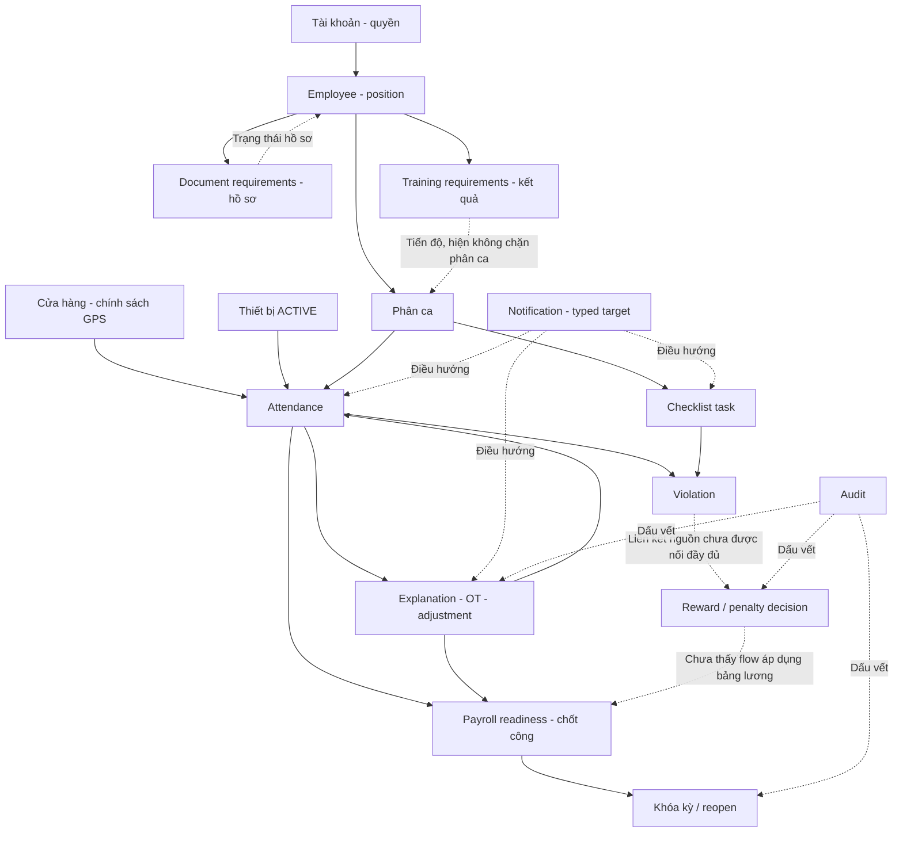

# HRM Coffee Shop — Ma trận liên kết nghiệp vụ

> Ma trận thiết kế trước triển khai; bản mapping đã thực hiện và kiểm thử nằm tại [IMPLEMENTED_FLOW_MATRIX.md](IMPLEMENTED_FLOW_MATRIX.md) và [VERIFICATION.md](VERIFICATION.md).

**Baseline đầy đủ:** Flutter và backend case1/c889df1; case2/0af31cb là checkout cũ để đối chiếu.  
**Phạm vi:** liên kết đang có trong source, liên kết đích và khoảng trống cần quyết định. Chưa xác minh runtime.

## 1. Bản đồ quan hệ chính

Nét liền thể hiện quan hệ nghiệp vụ trong source. Nét chấm ghi rõ quan hệ thông tin hoặc liên kết chưa hoàn chỉnh; không tự biến thành rule chặn.

## 2. Ma trận upstream → downstream

| Mã | Nguồn / trigger | Kết quả downstream có trong source | Loại phụ thuộc | Phần cần hoàn thiện |
|---|---|---|---|---|
| L01 | User/roles/permissions thay đổi | JwtAuthFilter tải lại quyền từ DB ở request tiếp theo | Bảo mật | Flutter tải lại session capability khi 403/đổi workspace/resume; không giữ menu theo quyền cũ vô thời hạn. |
| L02 | Admin tạo user | User tồn tại, chưa tự có Employee | Thiết lập nhân sự | UI dẫn tiếp tạo/liên kết Employee nếu nghiệp vụ cần; người thực hiện phải có EMPLOYEE_MANAGE. |
| L03 | Employee position/requirements thay đổi | DocumentService.profile/catalog và TrainingService requirements tính theo position/effective date | Dữ liệu dẫn xuất | Refresh profile/training requirements và hiển thị yêu cầu mới; chốt hiệu lực với nhân viên/ca đã tồn tại. |
| L04 | Admin đổi tọa độ/policy quán | Store current/settings cung cấp policy cho server và client; shift mới lấy một số cấu hình mặc định | Rule chấm công | Employee tải lại store; không dùng tọa độ hard-code. Cần phân biệt cấu hình áp dụng ngay với planned shift snapshot. |
| L05 | WorkShift được sửa | Assignment đã tạo giữ planned start/end; assignment mới dùng mẫu mới | Snapshot lịch | UI nêu rõ lịch cũ không tự đổi theo mẫu. Không sửa giờ lịch sử từ widget. |
| L06 | Employee ACTIVE + assignment PUBLISHED | Có thể vào time window check-in; employee/assignment ownership được kiểm | Hard gate server | Dashboard/current shift dẫn tới chấm công hoặc hướng xử lý blocker. |
| L07 | Device đăng ký | PENDING xuất hiện trong pending API và manager overview counts | Queue chờ xử lý | Register hiện chưa gọi notification tới Manager; discovery qua queue/refresh. Nếu cần báo ngay, bổ sung recipient policy. |
| L08 | Device approve/reject/revoke | Trạng thái thiết bị thay đổi, owner có in-app notification; approve khóa máy ACTIVE cũ | Hard gate check-in/out | Refresh devices/me và attendance/current ở Employee; tránh giữ device ID đã bị thay/thu hồi. |
| L09 | Training requirement chưa đạt | Requirements/progress và eligibility counts; eligibility hiện true | Thông tin, không phải gate | Giữ đào tạo không chặn phân ca/check-in theo định hướng đã có; không thêm điều kiện ở Flutter. |
| L10 | Document pending/review/expiry | Profile completeness được tính lại; finishReview gửi owner notification | Thông tin/profile | Submit hiện không gửi reviewer notification; queue pending đã có. Hồ sơ thiếu không phải check-in gate trong source. |
| L11 | Check-in trễ | Attendance metrics và ViolationEvent PENDING nếu rule active/chưa có event | Sự kiện nghiệp vụ | UI dẫn Employee tới công/vi phạm liên quan; không gọi đó là tiền phạt đã áp dụng. |
| L12 | Check-out sau planned end | Có raw OT interval trong tính toán/response | Dữ liệu để đề xuất | Không tự approve OT; Employee gửi request, Manager duyệt rồi mới tính approved OT. |
| L13 | Explanation approve | Có thể tạo/sửa Attendance, metrics và verification EXEMPTED; ABSENCE chỉ duyệt vắng | Thay đổi công / readiness | Refresh lịch sử/tổng hợp/readiness. Chưa có reconciliation violation/decision tự động sau sửa công. |
| L14 | Adjustment HR approve | Sửa một field Attendance; metrics, adjustment history, verification và audit cập nhật | Thay đổi công nhiều bước | Hai field là hai request; không có logical group ID. Review note/history chưa đầy đủ trong response detail. |
| L15 | OT approve/reject | Request state và approved OT metrics cập nhật nếu đã checkout | Công / readiness | Refresh Employee attendance/history, report, pending queue và readiness. |
| L16 | Checklist submit | SUBMITTED/PENDING hoặc APPROVED/NOT_REQUIRED; cần review thì notify Manager | Workflow thao tác | UI phân biệt “đã gửi” và “hoàn tất”; rejected có đường làm lại. |
| L17 | Checklist quá hạn/bỏ sót | Job có thể tạo violation theo rule và giới hạn nhắc | Sự kiện vận hành | Checklist chưa hoàn thành hiện không chặn checkout/payroll readiness; không tự thêm rule chặn. |
| L18 | Training quiz/manual review | EmployeeTraining/attempt và audit cập nhật | Kết quả đào tạo | Review/attempt hiện chưa gọi NotificationService; cần owner notification nếu sản phẩm yêu cầu. Queue non-quiz không yêu cầu employee submit. |
| L19 | Violation có explanation | Append immutable ViolationExplanation, giữ riêng manager review note | Chứng cứ / review | Reviewer cần thấy explanation trước quyết định; source chưa có bước UNDER_REVIEW độc lập. |
| L20 | Violation confirm | Violation API CONFIRMED; không tự tạo tiền phạt | Review kỷ luật | DecisionRequest chưa nhận violationEventId; create chưa ghi liên kết nguồn. Cần DEC-12 trước flow “tạo phạt từ vi phạm”. |
| L21 | Reward/penalty được duyệt | Decision APPROVED, monetary dashboard totals có thể đọc | Quyết định độc lập | Chưa thấy apply vào payslip/period hoặc state APPLIED; không báo đã trừ/cộng lương. |
| L22 | Readiness có blocker | Blocker type/count/sample IDs trả về | Gate finalize | Mỗi blocker phải dẫn tới loại đối tượng đúng; count không bằng số IDs sample. |
| L23 | Manager confirm kỳ | Period HR_REVIEW và attendance payroll status MANAGER_APPROVED | Bước chốt công | Current source không bắt readiness hết blocker tại bước này; cần quyết định nếu muốn chặn sớm. |
| L24 | Finalize/Reopen kỳ | Khóa/mở attendance và kỳ; lock guards chặn các write liên quan | Tính nhất quán dữ liệu | Refresh action availability trên nhiều module; không để form mở cũ báo thành công khi kỳ vừa bị khóa. |
| L25 | Notification đọc / delivery | Read state và delivery state riêng | Điều phối | Typed entity resolver, không phụ thuộc cache; push adapter hiện không gửi thật. |
| L26 | Mutation quan trọng | Audit action/entity/actor và before/after tùy service | Truy vết | Timeline người dùng cần API nghiệp vụ thích hợp; audit SYSTEM_ADMIN không được dùng làm workaround để mọi reviewer đọc history. |
| L27 | Employee cần giải trình ca không có/thiếu công | Backend hỗ trợ scheduleId + requestedCheckInAt/out để Manager approve | Dữ liệu đầu vào bắt buộc cho một số tình huống | Flutter case1 chỉ có entry từ attendance và repo không gửi requested times; cần khép bằng contract đã có, không cần phát minh endpoint. |

## 3. Những quan hệ không được tự suy diễn thành business rule

| Tình trạng | Source hiện tại | Thiết kế UI phù hợp |
|---|---|---|
| Chưa đủ training | Không chặn phân ca/check-in tại TrainingService.eligibility | Hiện tiến độ/nhắc học, giữ nút thao tác theo current shift/backend rules. |
| Hồ sơ INCOMPLETE/EXPIRED | Profile derived; không được AttendanceService dùng làm gate | CTA bổ sung hồ sơ; không tự cấm chấm công. |
| Checklist chưa xong | Không có check-out gate tương ứng trong AttendanceService | Nêu công việc còn lại; rule chặn cần quyết định/API riêng. |
| Có violation OPEN/CONFIRMED | Chưa đồng nghĩa có penalty decision | Hiện hồ sơ review và giải trình; tạo phạt là bước độc lập có quyền. |
| Penalty APPROVED | Chưa thấy apply vào payroll money | Gọi “quyết định đã duyệt”, không “đã trừ lương”. |
| Readiness READY | Chỉ dữ liệu không có blockers; period/date/permission vẫn cần kiểm tra | Hiện hai trục kỳ công và readiness, không tự gọi finalize. |
| Có PENDING ở hai module | Không cùng actor/transition | Detail/action theo từng domain, không gọi chung một approve endpoint. |

## 4. Refresh và đồng bộ màn hình sau mutation

Đích kiến trúc: repository/controller phát thông tin đối tượng đã đổi; lớp presentation invalidates các query liên quan. Source case1 đã refresh cục bộ sau action và có polling/resume trên check-in/device approval, nhưng chưa có dependency graph chung. Chưa có push delivery thật làm cơ chế đồng bộ đáng tin cậy.

| Mutation thành công | Màn/entity cập nhật ngay | Query/tổng hợp phải tải lại |
|---|---|---|
| User role/permission/status | Session/capabilities nếu user đang bị tác động | Router/menu/workspaces; admin user list/detail. |
| Employee/position thay đổi | Employee detail | Roster, profile derived, requirements, schedules/eligibility liên quan. |
| Store GPS/policy | Store settings | Store current, check-in screen preflight; giữ planned shift snapshot đúng source. |
| Assignment create/patch/cancel | Assignment detail | Manager/Employee schedule, dashboard next shift, attendance/current, notifications, readiness khi liên quan kỳ. |
| Device approve/reject/revoke | Device list/detail | Owner devices/me, current shift, Manager pending/counts. |
| Check-in/out | Attendance/current | History, schedule attendanceId, Employee overview, manager attendance stats, reports/readiness, violation list khi có phát sinh. |
| Explanation/adjustment/OT create | Request detail/list | Employee request history, Manager/HR queue/counts, attendance state, readiness. |
| Explanation/adjustment/OT review | Response entity; attendance bị tác động | Các queue/counters, Employee history, reports, readiness và verification/history. |
| Checklist item/evidence/submit/review/reassign | Run detail | Employee open tasks, Manager review queue, operations report, notification/violation liên quan. |
| Training enroll/quiz/manual review | Course enrollment/result | Requirements/progress, Employee dashboard tasks, training review queue; không thay khả năng nhận ca do UI suy luận. |
| Document submit/review/expiry | Documents catalog/history | Profile derived, employee detail/dashboard, reviewer queue/counts. |
| Violation/decision action | Detail và explanations/history | Employee history, Manager queues, reward dashboard; không tự sửa attendance hoặc salary. |
| Manager confirm/finalize/reopen | Period + readiness | Attendance lock state, request action availability, Manager/HR queues và reports. |
| Mark-read/read-all | Notification readAt | Unread count và badges. |

Không invalidate toàn bộ app sau mọi action. Giữ filter/scroll hiện tại và tải lại dữ liệu bị ảnh hưởng theo entity/date range.

## 5. Ma trận payroll blocker → màn xử lý

| Blocker type | IDs hiện trả là | Người xử lý chính / màn đích | Giới hạn và hướng xử lý |
|---|---|---|---|
| PENDING_ADJUSTMENT | AttendanceAdjustmentRequest IDs | Queue bước Manager hoặc bước cuối, tùy request status | Có GET adjustment-by-id; detail còn thiếu timeline notes đầy đủ. |
| PENDING_OVERTIME | OvertimeRequest IDs | Manager OT queue/detail | Chưa thấy GET request-by-id; cần contract detail cho direct link bền qua reload. |
| UNRESOLVED_EXCEPTION | AttendanceExceptionRequest IDs | Manager explanation queue/detail | Chưa thấy GET request-by-id; không chỉ tìm trong trang PENDING đầu tiên. |
| MISSING_CHECK_OUT | Attendance IDs | Attendance detail → explanation/adjustment phù hợp | Có GET attendance-by-id; phải giữ ý nghĩa thời gian theo workDate/overnight. |
| MISSING_ABSENCE_REQUEST | ShiftAssignment IDs | Period → sinh ABSENCE → assignment liên quan | Không dùng assignment ID như request ID. |
| PENDING_ABSENCE | ShiftAssignment IDs | Manager ABSENCE queue theo schedule | Cần tìm đúng request mới nhất cho schedule; IDs không phải exception request ID. |
| REJECTED_ABSENCE | ShiftAssignment IDs | Xem kết quả từ chối, xác định có tạo lại theo policy | Không auto approve hoặc auto tạo giờ công để bỏ blocker. |

Blocker.ids bị giới hạn tối đa 50 trong PayrollService.addBlocker. Nếu cần xử lý mọi mục, API phải có truy vấn drill-down/phân trang phù hợp; không đánh hết blocker sau khi xử lý hết sample.

## 6. Notification / deep-link target matrix

| relatedEntityType | Endpoint đọc chi tiết hiện có | Khả năng điều hướng và gap |
|---|---|---|
| ShiftAssignment | GET /shift-assignments/{id} | Có thể resolve độc lập; API vẫn kiểm tra scope. |
| Attendance | GET /attendance/{id} | Có detail. Notification Manager khi Employee gửi adjustment hiện trỏ Attendance; cần điều hướng tới adjustments của bản ghi, không chỉ ảnh/giờ công. |
| AttendanceAdjustmentRequest | GET /attendance/adjustment-requests/{id} | Có detail; route đích phân theo managerStatus/hrStatus và quyền. |
| ChecklistTask | GET /checklists/tasks/{id} | Có detail; Employee thực hiện hoặc Manager review theo capability/state. |
| EmployeeDocument | GET /documents/{id} | Có detail và URL xem mới có hạn; tải signed URL lúc mở. |
| ViolationEvent | GET /violations/{id}; GET explanations | Có detail; Employee và reviewer xem theo scope. |
| AttendanceDevice | Chỉ có mine, pending và by-employee lists trong inventory | Employee có thể tìm trong mine; reviewer không có GET-by-id bền vững nếu thiếu employee context. Không giả định object cache luôn còn. |
| AttendanceExceptionRequest | List mine/Manager và action APIs; chưa thấy GET-by-id | Cần detail contract hoặc truy vấn lookup có scope; list gần nhất/pending có thể không còn chứa object. |
| OvertimeRequest | List mine/Manager và action APIs; chưa thấy GET-by-id | Tương tự explanation; không route tới trang trống khi request đã review. |
| EmployeeRewardPenalty | List và action APIs; chưa thấy GET-by-id | Notification dùng numeric entityId, API decisionId là REWARD-{id}/PENALTY-{id}. Cần loại quyết định hoặc lookup canonical để xây đúng ID. |
| PayrollPeriod | GET period list và GET /{id}/readiness | Có thể ghép từ list + readiness nhưng chưa có period detail GET riêng; cần giữ period context khi reload. |
| Training review/result | Completion service chưa phát notification hiện tại | Nếu bổ sung, cần identity enrollment/course/employee rõ và endpoint đọc độc lập; không dùng mỗi courseId cho review một employee. |

Đề xuất resolver chỉ chấp nhận entityType đã đăng ký. Object không còn tồn tại/quyền đã mất hiển thị 404/403; không tự chọn một entity khác. Không tin arbitrary URL/route từ payload để bỏ qua guard.

## 7. Semantics của count và lịch sử

- Manager overview pending là tổng được repository tính, không phải số phần tử của trang đầu.
- Adjustment tạo một row cho mỗi field; một form đổi cả giờ vào/ra có thể tăng count hai. Cần đổi nhãn đơn vị hoặc bổ sung logical request contract.
- Document pending API hiện giới hạn top 100; Employee explanation/OT mine hiện giới hạn 50 gần nhất. Không dùng list.length của các API này làm tổng mọi trạng thái.
- Training review hiện trả toàn bộ queue không phân trang; có thể đọc count nhưng cần giữ semantics “enrollments non-quiz chưa có pass còn hiệu lực”, không “nhân viên báo đã hoàn thành”.
- Pending/rejected/approved không phải review timeline đầy đủ. Mỗi nghiệp vụ cần history contract nếu sản phẩm yêu cầu tên reviewer, thời điểm, lý do từng bước.
- Không dùng audit API SYSTEM_ADMIN làm nguồn history cho Employee/Manager không có quyền audit.

## 8. Contract gaps/proposals cần xem xét theo quyết định

| Mã | Nhu cầu | API có thể tái sử dụng | Khoảng trống thực sự / điều kiện đề xuất |
|---|---|---|---|
| CP-01 | Detail bền vững cho device/explanation/OT/decision/review enrollment | List/action APIs hiện có | GET-by-id hoặc lookup có scope; bổ sung khi direct link/reload detail là acceptance. |
| CP-02 | Employee báo hoàn thành non-quiz | Enrollment + manual review đã có | Chỉ cần submit-completion API nếu chọn flow employee self-report; flow review từ enrollment có thể dùng ngay. |
| CP-03 | Adjustment như một hồ sơ gồm nhiều field | Create trả List<AdjustmentView>, GET-by-id | Cần group/atomic transition và reviewer history nếu muốn một quyết định chung; không group bằng heuristic UI. |
| CP-04 | Tạo penalty từ violation | Violation detail + DecisionRequest | Request/create chưa lưu violationEventId; cần liên kết/validation đúng nguồn, chống tạo lặp theo policy. |
| CP-05 | Rà soát hậu quả sau sửa công | Metrics/history/violation APIs | Chưa có orchestration reconciliation; cần policy tác vụ/review, không auto xóa quyết định tài chính. |
| CP-06 | Dashboard task orchestration | Manager pending/nextActions đã có | Bổ sung training queue, quyền theo queue, thời điểm/hạn và priority nếu được chốt; tránh tạo API trùng. |
| CP-07 | Payroll blocker drill-down | Readiness type/count/sample IDs | Cần typed object refs và truy vấn phân trang để xử lý toàn bộ; sample 50 chưa đủ cho tất cả dữ liệu. |
| CP-08 | Tái hiện quiz attempt | QuizResultView, TrainingAttempt điểm tổng | Cần question version/answers snapshot và attempt detail nếu yêu cầu chứng cứ đào tạo. |
| CP-09 | Kết quả tính lương tiền | Payroll periods/readiness/chốt công | Chưa có payslip/calculation/line items/apply decision flow; là phạm vi sản phẩm mới cần đặc tả. |
| CP-10 | Notification đích chính xác/đủ người nhận | relatedEntityType/Id + inbox | Cần metadata tối thiểu cho decision type/enrollment/request context và recipient policy ở các trigger chưa notify. |

Mỗi proposal phải ghi actor, quyền đọc/action, request/response, validation, state transition, audit, ảnh hưởng dữ liệu và acceptance. Không bổ sung API chỉ vì một màn chưa được dựng.

Các việc không cần API mới: đưa requestedCheckInAt/out vào explanation form/repo, entry từ assignment chưa có attendance, nhập OT start/end đủ ngày, mapping trạng thái đúng DTO và dùng capability lọc các API đã có.
