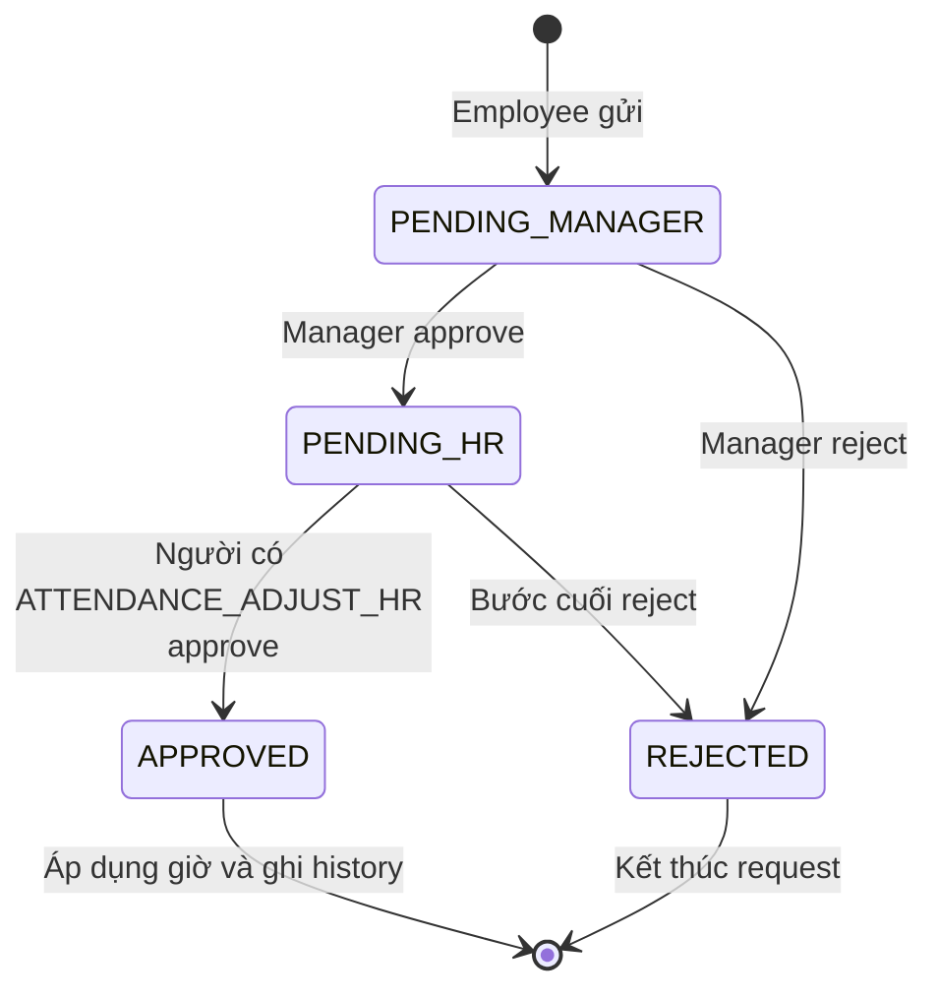
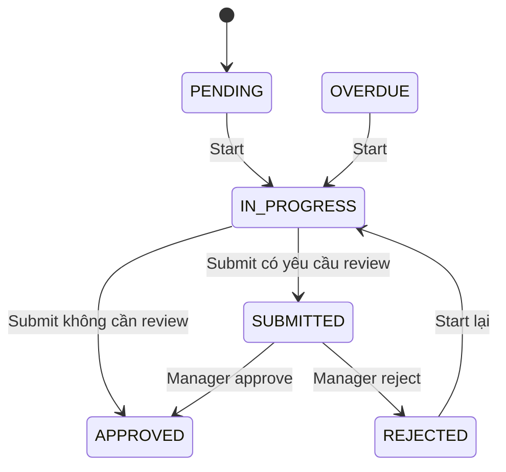
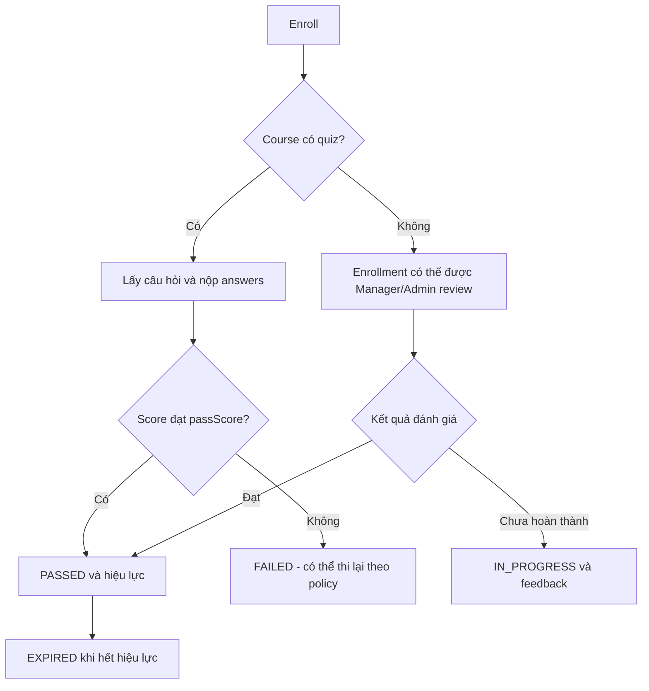
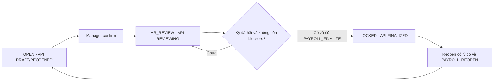

# HRM Coffee Shop — Flow end-to-end và catalog trạng thái

> Catalog ở thời điểm review. Source đã được triển khai tiếp; đối chiếu [IMPLEMENTED_FLOW_MATRIX.md](IMPLEMENTED_FLOW_MATRIX.md) để biết route/contract hiện tại và [VERIFICATION.md](VERIFICATION.md) cho bằng chứng runtime.

**Baseline đầy đủ:** Flutter và backend case1/c889df1; working tree case2/0af31cb chỉ dùng đối chiếu lịch sử.  
**Mức xác minh:** đọc source; chưa chạy API/app/test/SQL Server.  
**Thiết kế đích:** phục vụ EMPLOYEE, STORE_MANAGER, SYSTEM_ADMIN; các bước HR được cấp bằng permission.

Đọc cùng [ARCHITECTURE_WORKFLOW_REVIEW.md](ARCHITECTURE_WORKFLOW_REVIEW.md), [BUSINESS_LINKAGE_MATRIX.md](BUSINESS_LINKAGE_MATRIX.md) và [BUSINESS_DECISION_REGISTER.md](BUSINESS_DECISION_REGISTER.md).

## 1. Nguyên tắc chuẩn hóa trạng thái

Chuẩn hóa ở đây là làm rõ ý nghĩa và cách hiển thị trạng thái theo contract. Không biến mọi nghiệp vụ thành một enum PENDING/APPROVED chung, không tự đổi giá trị DB/API.

Một đối tượng có thể đồng thời có:

- Pha xử lý: chưa bắt đầu, đang làm, chờ duyệt, hoàn tất.
- Bước duyệt: Manager, bước cuối theo permission hoặc không cần duyệt.
- Kết quả: đạt, không đạt, đi muộn, thiếu checkout, bị từ chối.
- Điều kiện hiệu lực: còn hạn, hết hạn, đã khóa.
- Trạng thái thao tác cục bộ: đang upload/submit, lỗi mạng, đang refresh.

Ví dụ: một attendance đã CHECKED_OUT có thể có recordStatus=LATE và payrollStatus=OPEN. Một kỳ công có dữ liệu READY nhưng vẫn chưa được Manager xác nhận. Một notification đã đọc vẫn có thể gửi push thất bại.

### Presentation model đề xuất

| Thuộc tính | Ý nghĩa |
|---|---|
| domainType, entityId | Định danh đúng nghiệp vụ và đối tượng. |
| sourceStatus / sourceFields | Giữ nguyên status/field từ DTO để truy vết và xử lý unknown. |
| phase | Nhóm hiển thị: notStarted, inProgress, waiting, needsAction, completed, cancelled, expired. Đây là projection UI. |
| reviewStage | NONE, MANAGER, FINAL_REVIEW hoặc tên bước backend thực tế; không suy từ màu badge. |
| outcome | Kết quả domain: passed/failed, late/early leave, approved/rejected... |
| blockers | Lý do chặn do API hoặc kiểm tra thiết bị trả về, có hướng xử lý. |
| nextActor / nextAction | Tác vụ tiếp theo sau khi kiểm tra role/permission và trạng thái. |
| dueAt / effectiveUntil | Hạn xử lý và hiệu lực; không nhầm expiry với bị từ chối. |

Business state chỉ cập nhật sau response đã xác nhận. Loading, uploading, submitting và failure nằm trong operation state; không ghi chúng vào status nghiệp vụ. Không map status chưa nhận biết thành “Hoàn thành”; hiển thị trạng thái chưa hỗ trợ và cho tải lại.

## 2. Catalog trạng thái hiện có trong source

| Domain | Public API / field thực tế | Ý nghĩa và cách hiển thị | Điều cần tránh |
|---|---|---|---|
| User account | ACTIVE, LOCKED, INACTIVE, PENDING | Trạng thái tài khoản, khác employment status và role. | Không coi employee ACTIVE là user đã được phép login. |
| Employee | ACTIVE, ON_LEAVE, SUSPENDED, RESIGNED | Trạng thái làm việc; rule ACTIVE được kiểm ở phân ca/check-in. | Không dùng như trạng thái đang có mặt tại quán. |
| Profile | COMPLETE, UNDER_REVIEW, EXPIRED, INCOMPLETE được tính từ document requirements | Dùng trạng thái tính từ detail/catalog/overview; Employee.ProfileStatus là cache và EXPIRED được lưu cache thành INCOMPLETE. | Không lấy cache làm nguồn duy nhất hoặc tự chặn check-in vì hồ sơ thiếu. |
| Assignment | status: DRAFT, PUBLISHED, CANCELLED, COMPLETED theo schema | Source create đặt PUBLISHED; patch/cancel có rule riêng. Planned timestamps là nguồn giờ/ngày. | Chưa thấy publish hoặc complete action riêng; không tạo flow công bố chỉ từ enum. |
| Attendance | AttendanceView.attendanceStatus: CHECKED_IN, CHECKED_OUT, REVIEW_REQUIRED, ADJUSTMENT_PENDING, FINALIZED | Đây là trạng thái API đã quy đổi; hiển thị cùng timestamps và recordStatus. | Không gửi status API vào cột AttendanceStatus trong DB. |
| Attendance result | AttendanceView.recordStatus: IN_PROGRESS, PRESENT, LATE, EARLY_LEAVE, EXPLANATION_PENDING, APPROVED_EXCEPTION | Dùng cùng lateMinutes, earlyLeaveMinutes, workedMinutes; hai loại đi muộn/về sớm có thể cùng có số phút. | Không dùng một badge để làm mất tình trạng còn lại. |
| Attendance payroll | OPEN, MANAGER_APPROVED, HR_APPROVED, LOCKED | Khóa/chốt công là trục riêng. FINALIZED public có thể che pha CHECKED_IN/OUT; dùng timestamp để biết diễn biến. | Không coi FINALIZED là bằng chứng đã có bảng lương tiền. |
| Device | PENDING, ACTIVE, LOCKED, REJECTED, REVOKED | PENDING chờ duyệt, LOCKED có thể do thay máy, REVOKED là thu hồi có chủ đích. | Không gom LOCKED/REJECTED/REVOKED thành một nhãn “chưa duyệt”. |
| Explanation/ABSENCE | API PENDING_MANAGER, APPROVED, REJECTED, CANCELLED; DB PENDING được map sang PENDING_MANAGER | Giải trình và đơn vắng cùng storage model nhưng khác hiệu ứng; ABSENCE approve không tạo công. | Không dùng approve ABSENCE để báo đã có giờ làm. |
| Overtime | PENDING, APPROVED, REJECTED, CANCELLED | Được duyệt mới được tính vào approved OT; khoảng giờ đủ ngày/offset. | Giờ checkout muộn không tự thành OT. |
| Adjustment | status: PENDING_MANAGER, PENDING_HR, APPROVED, REJECTED; có managerStatus và hrStatus | Hiện từng bước và kết quả; REJECTED được suy từ một trong hai reviewer status. | Không báo hoàn tất sau Manager approve; không đếm 2 dòng đổi giờ thành 1 form nếu không có group contract. |
| Checklist | runStatus: PENDING, IN_PROGRESS, SUBMITTED, OVERDUE, APPROVED, REJECTED, WAIVED; managerStatus riêng | SUBMITTED/PENDING là chờ Manager; APPROVED/NOT_REQUIRED có thể là tự hoàn tất khi không cần review. REJECTED được start lại theo source. | WAIVED có ở schema nhưng chưa thấy waiver action. OVERDUE không phải bằng chứng đã phát sinh penalty. |
| Training | status: NOT_STARTED, IN_PROGRESS, PENDING_REVIEW, PASSED, FAILED, EXPIRED; requirements có NOT_ENROLLED | Quiz tự chấm; non-quiz được review thủ công. EXPIRED có thể được tính lúc đọc trước khi job cập nhật DB. | Enrollment không là hoàn thành; queue manual hiện không đồng nghĩa employee đã submit completion. |
| Employee document | reviewStatus: PENDING, APPROVED, REJECTED, EXPIRED | Một hồ sơ là một lần nộp; profile là tổng hợp theo yêu cầu chức vụ. | Không coi một giấy tờ APPROVED là mọi hồ sơ đều COMPLETE. |
| Violation | API OPEN, CONFIRMED, DISMISSED, RESOLVED, CANCELLED; DB PENDING/APPROVED/REJECTED/APPLIED/CANCELLED | OPEN ↔ PENDING, CONFIRMED ↔ APPROVED, DISMISSED ↔ REJECTED, RESOLVED ↔ APPLIED. | UNDER_REVIEW được nhận như filter alias về PENDING; chưa có state xử lý riêng. Không coi CONFIRMED là đã phạt tiền. |
| Reward/penalty | API PENDING_APPROVAL, APPROVED, REJECTED, CANCELLED, APPLIED | Decision là hồ sơ riêng; source API map DB PENDING thành PENDING_APPROVAL. | Chưa thấy đường source chuyển sang APPLIED; không tự đánh “đã vào lương”. |
| Payroll period | PeriodView.status: DRAFT, REVIEWING, READY, FINALIZED, REOPENED; ReadinessView.periodStatus giữ state lưu DB | DB: OPEN/MANAGER_REVIEW/HR_REVIEW/APPROVED/LOCKED. UI dùng periodStatus/approval timestamps để biết bước thực tế. | PeriodView.REVIEWING không tự phân biệt Manager/HR. Chưa thấy action chuyển DB APPROVED. |
| Payroll readiness | READY, NOT_READY, FINALIZED và canFinalize/blockers | Source canFinalize hiện phản ánh không còn blockers; finalize service còn kiểm tra HR_REVIEW, kỳ đã kết thúc và quyền. | Không bật finalize chỉ dựa canFinalize=true. Dữ liệu READY có thể đi cùng kỳ còn DRAFT. |
| Notification | readAt độc lập với deliveryStatus PENDING/SENT/FAILED/CANCELLED | Đã đọc và đã gửi là hai trục khác nhau. | Không dùng SENT như đã đọc hoặc record tồn tại như push đã tới máy. |

### Khác biệt giữa API cần giữ khi tích hợp

- /attendance/me/current gọi apiStatus với checkAdjustments=false; attendance detail/history kiểm tra pending adjustments. Hai response không phải lúc nào trả cùng status.
- CurrentShiftView.canCheckIn/canCheckOut là preflight theo dữ liệu server hiện có. GPS/ảnh/policy và khóa kỳ được xác minh lại khi submit; flag true không đảm bảo request sẽ thành công.
- AdjustmentView hiện không trả đầy đủ manager/HR note, reviewer hoặc thời điểm từng bước, dù một số field tồn tại ở entity/audit. Không thể dựng timeline duyệt đầy đủ từ DTO hiện hành.
- Blocker.count là tổng số; Blocker.ids chỉ tối đa 50. Cần giữ tổng và danh sách sample tách biệt.
- Schema chấp nhận một số trạng thái chưa tìm thấy producer trong service: assignment COMPLETED, checklist WAIVED, violation/decision APPLIED, payroll period APPROVED. Các trạng thái này không cấp thêm action UI.
- Flutter case1 đã có formatters nhưng employeeProfileStatusLabel xử lý PENDING_REVIEW thay vì UNDER_REVIEW, chưa map EXPIRED; shiftEligibilityLabel chưa map RESTRICTED; attendanceStatusLabel chưa dịch REVIEW_REQUIRED/ADJUSTMENT_PENDING/FINALIZED; trainingStatusLabel map mọi giá trị lạ thành “Chưa ghi danh”. Cần hoàn thiện mapping có test contract, không dùng fallback đó như business truth.

## 3. Các máy trạng thái trọng tâm

### Adjustment: từng request hiện là một trường giờ

Source chặn reviewer là chính requester; chưa thấy rule bắt Manager reviewer khác HR reviewer. Nếu cùng user có đủ quyền, hai bước có thể do cùng người xử lý. Phân tách người duyệt là quyết định cần chốt.

### Checklist: source đã có đường làm lại

Quá hạn còn được biểu diễn bằng dueAt/startedAt/submittedAt và job. Thông tin “trễ hạn” nên giữ cùng kết quả hoàn tất; UI không tự ghi vi phạm.

### Training: hai cách xác nhận

Flow manual trên phản ánh source và yêu cầu đơn giản trước đó: review từ enrollment. Nếu chọn thêm bước Employee “Tôi đã hoàn thành”, cần contract/state PENDING_REVIEW mới được sử dụng đúng nghĩa. Đó là tùy chọn sản phẩm, không phải API đã tồn tại.

### Kỳ công và readiness là hai trục

Readiness READY/NOT_READY được tính độc lập. ManagerConfirm hiện có thể thực hiện dù còn blockers; HR finalize mới chặn readiness. UI có thể cảnh báo, còn thay rule chặn Manager confirm cần quyết định nghiệp vụ.

## 4. Flow end-to-end đích và khoảng trống hiện tại

### F01 — Đăng nhập, khôi phục phiên và đổi workspace

1. Mở app/deep link → restore phiên → refresh khi cần.
2. Login Google theo /auth/google nếu chưa có phiên.
3. Nạp /users/me, /users/me/permissions và employee link khi cần.
4. Resolve workspace trong ba role; nếu nhiều workspace thì cho chọn.
5. Resolve route/entity đích, kiểm tra capability, tải dữ liệu thật.
6. Logout gọi API và xóa session; 401 không refresh được quay login; 403 hiển thị thiếu quyền.

Flutter case1 đã có AuthRepository, Google login, restore token, đọc permissions, secure storage và refresh single-flight. Khoảng trống là SessionController/router guard trung tâm, phục hồi /select-workspace không phụ thuộc User trong state.extra, và điều hướng khi refresh thất bại. Backend không có public email-password signup trong inventory; Register chỉ nên thể hiện quy trình do Admin cấp tài khoản.

### F02 — Từ tài khoản đến nhân viên sẵn sàng làm việc

1. Admin tạo user và gán roles/permissions theo catalog.
2. Người có EMPLOYEE_MANAGE tạo Employee liên kết user, chọn position/employment data.
3. Employee nhận catalog giấy tờ và training requirements theo position.
4. Employee nộp giấy tờ, đăng ký device, ghi danh đào tạo nếu cần.
5. Reviewer có quyền xem xét hồ sơ/device/training đúng loại.
6. Manager phân ca cho employee ACTIVE, không overlap và ngoài kỳ khóa.

Nguồn hiện tại: tạo user không tự tạo Employee. Training chưa hoàn thành không chặn phân ca/check-in; thiếu hồ sơ được phản ánh trong profile nhưng AttendanceService không dùng nó làm gate. Không tự thêm gate trong Flutter.

Cần người phụ trách EMPLOYEE_MANAGE và các bước review trong ba role; cấp role SYSTEM_ADMIN đơn lẻ không thay thế mọi authority của HR controller.

### F03 — Admin thiết lập vị trí quán bằng GPS

1. Admin mở store settings, tải dữ liệu hiện tại.
2. Bấm lấy vị trí thiết bị → xin quyền → đo GPS thật và hiển thị tọa độ/độ chính xác để xác nhận.
3. Gửi PATCH /admin/store-settings với latitude/longitude và cấu hình đã nhập; giữ validation policy backend.
4. Response thành công cập nhật store view.
5. Khi Employee mở chấm công, tải /stores/current để dùng vị trí mới.
6. Nếu GPS bị từ chối/sai số lớn, giữ form và chỉ dẫn cấp quyền/đo lại; không thay bằng tọa độ mẫu.

AdminSystemSettingsPage case1 đã có lấy GPS điền tọa độ, lưu store settings qua API. Cần nghiệm thu chuỗi này trên thiết bị; môi trường emulator phải cung cấp vị trí/camera của emulator. Ảnh preview ảo không chứng minh webcam thật hoặc face verification đã hoạt động.

### F04 — Tạo ca, phân ca, xem lịch

1. Manager/Admin tạo work shift bằng API có quyền tương ứng.
2. Manager chọn employee, shift, workDate, kiểm tra overlap/eligibility và gửi assignment.
3. Source create trả assignment PUBLISHED ngay; không có bước publish API riêng.
4. Employee thấy lịch, plannedStartAt/plannedEndAt đủ ngày; shift qua đêm hiển thị cả ngày kết thúc.
5. Manager patch/cancel theo rule; ca đã phát sinh attendance không sửa/hủy như ca chưa làm.
6. Notification mở đúng assignment; các màn schedule/dashboard/attendance current tải lại.

DEC-06 chốt giới hạn ca, semantics DRAFT/PUBLISHED và chính sách thay đổi ca; không tự biến ca test gần 24 giờ thành quy tắc vận hành.

### F05 — Check-in và check-out thật

1. Tải current shift, store, devices/me; hiện giờ, trạng thái, blocker và CTA khắc phục.
2. Cho mở screen cả khi chưa được submit để Employee hiểu lý do.
3. Xin GPS/camera đúng lúc, đo vị trí mới, chụp ảnh và xem lại/chụp lại.
4. Upload raw bytes purpose=ATTENDANCE → nhận storageKey; upload lỗi không chuyển sang thành công.
5. Tạo và giữ idempotency key cho một thao tác; gửi check-in/out.
6. Chỉ sau response thành công mới cập nhật kết quả; tải lại current/history/assignment/overview.
7. Timeout sau submit: giữ key, đọc lại trạng thái hoặc retry cùng key; không tạo key mới tùy tiện.

Các lỗi device/GPS/time/payroll/ảnh phải có hướng xử lý riêng. Check-out không tự sinh overtime. Face adapter mặc định NOT_RUN; nhãn “Ảnh bằng chứng” phù hợp hơn khẳng định nhận diện khuôn mặt thành công khi chưa có kết quả thật.

EmployeeCheckInPage case1 đã thực hiện chuỗi upload → check-in/out thật, lấy store từ API, poll/resume refresh và giữ retry key trong state widget. Cần hoàn thiện hai điểm: key chưa được giữ qua app restart; thiết bị được chọn bằng record ACTIVE đầu tiên của employee, còn CheckInRequest chỉ mang deviceId và server kiểm tra owner/status. Chưa có bằng chứng ràng buộc record đó với đúng cài đặt/thiết bị đang gửi request.

### F06 — Chọn đúng loại yêu cầu chấm công

| Tình huống | Flow đúng theo source |
|---|---|
| Không có attendance vì GPS/thiếu chấm công | Explanation gắn scheduleId; Manager review. |
| Có attendance cần sửa giờ đã ghi | Adjustment gắn attendanceId; Manager rồi bước cuối được cấp quyền. |
| Làm thêm sau planned end | Overtime request có đầy đủ thời điểm bắt đầu/kết thúc; Manager review. |
| Ca vắng không có công sau khi kết thúc | ABSENCE request theo quy trình sinh/xử lý; approve ghi nhận vắng, không ghi giờ làm. |

Mỗi form giữ evidence, lý do và lịch sử theo contract riêng. Form adjustment gửi hai giờ tạo hai request; hiện chưa có group ID hoặc atomic approval chung. Detail phải nêu rõ giờ vào/giờ ra đang ở bước nào.

Gap Flutter case1 đã xác minh: _showExplanation chỉ mở từ attendance row và EmployeeRepository.createExplanation không nhận/gửi requestedCheckInAt/out. Với ca chưa có công, chưa có entry từ EmployeeSchedule; với thiếu giờ, reviewer không có thời gian đề xuất để approve tạo/hoàn thiện công. DTO/backend đã hỗ trợ các field này nên cần hoàn thiện form/repository theo contract hiện có. OT form hiện dùng một date cho cả start/end; cần hai ngày/thời điểm để biểu diễn khoảng qua đêm.

Ví dụ suy ra từ source, chưa chạy tái hiện: Employee chọn “Quên check-out” nhưng chỉ nhập lý do; Manager có thể duyệt một attendance đã có check-in, song không có requestedCheckOutAt để ghi giờ ra. Request được APPROVED trong khi readiness vẫn có MISSING_CHECK_OUT. Acceptance phải kiểm tra dữ liệu công đã được sửa, không chỉ snackbar hoặc status request.

Sau review: refresh attendance, requests, manager counts, reports và payroll readiness. Không cập nhật trạng thái cuối từ Manager approval của adjustment.

### F07 — Checklist từ template đến làm lại

1. Admin tạo/sửa/activate template. Source sửa template đã dùng tạo version mới, run cũ giữ version cũ.
2. Manager generate từ schedule hoặc employee/date; giao/reassign theo state.
3. Employee start, hoàn thành từng item, upload evidence theo yêu cầu.
4. Submit → APPROVED nếu không cần review, hoặc SUBMITTED/PENDING chờ Manager.
5. Manager approve/reject; reject có lý do.
6. Employee mở lý do, start lại và hoàn tất theo source cho phép; review history được giữ.

Cần chốt khi reassign checklist đã làm dở có giữ phần đã hoàn thành và evidence người cũ hay không. Chưa có waiver action dù WAIVED có trong schema.

### F08 — Khóa học, quiz và xác nhận thủ công

1. Admin tạo course với mô tả, passScore, validity, isMandatoryTest; nếu có quiz, quản lý câu hỏi/đáp án.
2. Employee xem requirements/catalog và enroll.
3. Course quiz: GET quiz → chọn A–D chữ hoa → submit answers → backend trả điểm/kết quả → cập nhật training.
4. Course non-quiz: Manager/Admin xem enrollment cần đánh giá → approve hoặc not-complete kèm feedback.
5. Employee tải lại kết quả, completion date/expiry và feedback.
6. Hết hiệu lực hiện EXPIRED; flow renew/retake dùng rule backend và policy đã chốt.

Source course hiện có description và question bank; chưa thấy lesson/media/progress tracking đầy đủ. Không gọi mở course là đã học xong. TrainingService completion review hiện không gọi NotificationService; nếu yêu cầu thông báo kết quả cần bổ sung liên kết.

Manager manual attempt/score API vẫn tồn tại cho cả course test theo quyền. Cần quyết định phạm vi dùng đường này để không vô tình bỏ qua quiz policy.

### F09 — Giấy tờ và profile completeness

1. Employee tải documents/catalog để biết loại bắt buộc, latestStatus, canSubmit và blockReason.
2. Chọn file, upload purpose=DOCUMENT, nộp SubmitRequest.
3. PENDING → reviewer có DOCUMENT_REVIEW mở detail và signed view URL.
4. Approve/reject → Employee thấy kết quả/lý do; profile được tính lại theo requirements.
5. Hồ sơ REJECTED/EXPIRED có thể nộp bản mới khi catalog cho phép; giữ lịch sử các lần nộp.
6. Hồ sơ PENDING hoặc APPROVED còn hiệu lực hiện chặn nộp cùng loại theo source; early renewal là quyết định riêng.

Không hiển thị storage key cho người dùng. Không đánh profile COMPLETE dựa trên một file bất kỳ.

### F10 — Vi phạm, giải trình và quyết định thưởng/phạt

1. Attendance đi muộn/checklist bỏ sót có thể sinh ViolationEvent OPEN; chưa trừ tiền tự động.
2. Employee xem violation và gửi explanation/evidence khi còn mở.
3. Reviewer đọc violation/explanations rồi confirm hoặc dismiss theo quyền thực tế và severity.
4. Nếu cần penalty, tạo Decision riêng; người đề xuất khác người duyệt và khác employee được xét.
5. Decision approval/rejection/cancel theo rule; critical/ngưỡng cần quyền bổ sung.
6. Employee xem quyết định và kết quả.

Source hiện chưa nối DecisionRequest/create tới violationEventId. Correction attendance cũng chưa tự rà soát lại violation/decision. Đây là khoảng trống cần chốt trước khi coi chuỗi violation → penalty → kỳ công/tính lương đã hoàn chỉnh.

### F11 — Đối soát và chốt kỳ công

1. Người có quyền tạo kỳ không overlap; Manager mở readiness.
2. Mở từng blocker để xử lý adjustment, OT, explanation, missing checkout hoặc ca vắng.
3. Sinh/xử lý ABSENCE requests khi có ca đã kết thúc không chấm công.
4. Manager confirm → HR_REVIEW; người được cấp bước cuối kiểm tra lại state, ngày kết thúc và readiness.
5. Finalize → LOCKED/FINALIZED; các write nghiệp vụ trong kỳ bị chặn theo lock guard.
6. Reopen có quyền và lý do → OPEN/REOPENED → đối soát lại → confirm/finalize lại.

Source readiness không dùng training/checklist chưa hoàn tất hay pending rewards/violations làm blocker. Không tự thêm blocker từ Flutter. Source hiện tập trung chốt công; chưa có payslip/calculation/line items và chưa thấy reward/penalty được chuyển APPLIED.

### F12 — Notification, review detail và audit

1. Notification inbox tải từ API, read state riêng với delivery.
2. Chọn notification → resolve relatedEntityType/Id → kiểm tra quyền → tải entity → mở detail đúng workspace.
3. Entity đã mất/quyền đã đổi hiển thị trạng thái rõ; không route về màn không liên quan.
4. GET-by-id thiếu phải được giải quyết bằng contract đọc detail hoặc fallback list có thể tìm đúng đối tượng; không chỉ phụ thuộc object trong RAM.
5. Action xong cập nhật detail/queue/dashboard; backend audit là dấu vết quyết định.
6. Admin đọc audit/deliveries theo quyền; file signed URL hết hạn lấy lại qua endpoint nghiệp vụ.

Flutter notification inbox case1 đã có API list/pagination/read/read-all và normalize type → notificationType. Hiện onTap chỉ gọi markRead, chưa resolve relatedEntityType/Id để mở nghiệp vụ. Đây là gap cần bổ sung, không phải thiếu inbox.

## 5. Tiêu chí nghiệm thu từng flow khi triển khai

Các tình huống dưới đây là tiêu chí đích, chưa được thực hiện trong source review này.

| Tình huống | Kết quả cần chứng minh trên app và API thật |
|---|---|
| EMPLOYEE đăng nhập | Đúng profile/employee/workspace, không vào Manager mặc định. |
| User nhiều role | Đổi workspace giữ phiên và chỉ thấy capability thực tế. |
| Admin GPS → Employee check-in | Vị trí lưu thành công; Employee dùng cấu hình mới, ảnh upload và attendance persist sau reload. |
| Device pending → approved → revoked | Employee thấy từng trạng thái; current shift/action thay đổi sau refresh. |
| Ca qua đêm | Ngày kết thúc, công, OT, lịch và readiness nhất quán theo timestamps. |
| Check-in retry/mạng lỗi | Một nghiệp vụ được ghi; cùng key có thể khôi phục kết quả; không báo thành công giả. |
| Adjustment hai bước | Manager approve vẫn PENDING_HR; bước cuối áp dụng và ghi history; reject đúng stage. |
| Checklist reject → làm lại | Lý do còn hiển thị, Employee làm lại/nộp, Manager thấy phiên review mới. |
| Quiz/manual training | Quiz chấm ở backend; manual review theo policy đã chọn; pass/expiry/feedback persist. |
| Documents reject/expiry → nộp lại | Catalog cho phép đúng rule, lịch sử không mất, profile tính lại. |
| Violation/penalty | Giải trình và quyết định riêng; không tự phạt hoặc tự duyệt; link nguồn rõ nếu được triển khai. |
| Kỳ công bị chặn/finalized/reopen | Blocker dẫn đến đúng đối tượng; đủ điều kiện mới finalize; kỳ khóa ngăn write; reopen có audit. |
| Notification deep link sau restart | Đăng nhập lại vẫn tải đúng đối tượng, back đúng module, 403/404 xử lý rõ. |
